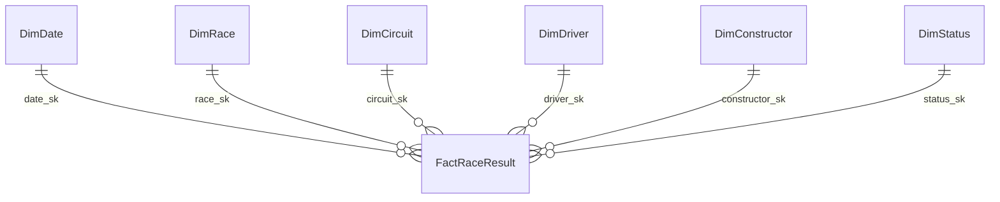

# Data Warehouse Data Dictionary (`dw`)

> **Phiên bản:** P2-v1.1 · **Ngày:** 2026-11-06 · **Tác giả:** Lộc
> **Phạm vi:** 1 fact (`FactRaceResult`) và 6 dimensions, theo star schema trong [`dimensional_model.md`](../01_architecture_and_design/dimensional_model.md).
> **Quy tắc chuyển đổi:** [`stage_to_dw_mapping.md`](stage_to_dw_mapping.md).
> **Trạng thái:** Đặc tả đích. Đã kiểm chứng bằng bản dựng tạm theo đặc tả trên SQL Server 2022 (43/43 check PASS, xem [`loc_phase2_validation_run.md`](../evidence/loc_phase2_validation_run.md)). Sau khi Trực hoàn thành dbt models, chạy lại [`loc_semantic_validation.sql`](../../sqlserver/dw/loc_semantic_validation.sql) trên `dw` thật. Dũng bổ sung dung lượng và độ nén columnstore vào mục 9.
> **Lưu ý tên cột:** từ điển dùng `snake_case` theo quyết định D1. Script hiện tại của Dũng dùng PascalCase; bảng đối chiếu ở [mục 10 tài liệu mapping](stage_to_dw_mapping.md#10-đối-chiếu-với-script-dw-của-dũng-nhánh-origindung-commit-46e72ed).

## Quy ước

- Tên bảng PascalCase (tạo bằng `alias` trong dbt); tên cột `snake_case`.
- `*_sk` là surrogate key xác định (deterministic): bằng khóa nguồn, riêng `date_sk` có dạng `YYYYMMDD`. `-1` là Unknown member.
- `source_*_id` là khóa tự nhiên từ nguồn Kaggle/Ergast, dùng để truy vết.
- **Loại measure:**
  - `A` (additive): cộng được theo mọi chiều.
  - `N` (non-additive): chỉ AVG, MEDIAN, MIN hoặc MAX trên tập hợp lệ.
  - `F` (flag): cờ 0/1, SUM ra số đếm.
- Ví dụ lấy từ `resultId = 1`: Lewis Hamilton, McLaren, 2008 Australian Grand Prix (`raceId = 18`, ngày 2008-03-16).

---

## 1. `dw.FactRaceResult`

**Grain:** 1 dòng cho mỗi `results.resultId`, tức một tay đua tại một Grand Prix.
**Số dòng kỳ vọng:** 27.568.
**Nạp:** incremental, `delete+insert` theo `source_result_id`.
**Index:** clustered columnstore (Dũng).

| Cột | Kiểu | Null | Loại | Ý nghĩa | Ví dụ |
|---|---|:---:|:---:|---|---|
| `source_result_id` | INT | N | khóa | `resultId` nguồn, duy nhất | `1` |
| `date_sk` | INT | N | FK | → `DimDate`, ngày đua | `20080316` |
| `race_sk` | INT | N | FK | → `DimRace` | `18` |
| `circuit_sk` | INT | N | FK | → `DimCircuit`, lấy qua race | `1` |
| `driver_sk` | INT | N | FK | → `DimDriver` | `1` |
| `constructor_sk` | INT | N | FK | → `DimConstructor` | `1` |
| `status_sk` | INT | N | FK | → `DimStatus` | `1` |
| `source_race_id` | INT | N | lineage | `raceId` nguồn | `18` |
| `source_driver_id` | INT | N | lineage | `driverId` nguồn | `1` |
| `source_constructor_id` | INT | N | lineage | `constructorId` nguồn | `1` |
| `source_status_id` | INT | N | lineage | `statusId` nguồn | `1` |
| `car_number` | INT | Y | thuộc tính | Số xe trong race | `22` |
| `position_text` | NVARCHAR(10) | N | thuộc tính | Vị trí dạng text nguồn: số, `R`, `D`, `E`, `W`, `F`, `N` | `1` |
| `result_outcome_code` | VARCHAR(20) | N | thuộc tính | Kết quả chính thức của dòng, suy ra từ `position_text` | `CLASSIFIED` |
| `finish_time_text` | NVARCHAR(50) | Y | thuộc tính | Thời gian về đích hoặc khoảng cách dạng text | `1:34:50.616` |
| `points` | DECIMAL(6,2) | N | A | Điểm Grand Prix (không gồm sprint) | `10.00` |
| `laps_completed` | INT | N | A | Số vòng tay đua hoàn thành | `58` |
| `result_count` | INT | N | A | Luôn bằng 1, dùng để đếm số lượt tham gia | `1` |
| `grid_position` | INT | N | N | Vị trí xuất phát; `0` = pit lane hoặc không có | `1` |
| `finish_position` | INT | Y | N | Vị trí xếp hạng; NULL = không được xếp hạng | `1` |
| `position_order` | INT | N | N | Thứ tự nguồn dùng để xác định người thắng | `1` |
| `places_gained` | INT | Y | N | `grid - finish`, chỉ khi `grid > 0` và có `finish_position` | `0` |
| `is_win` | BIT | N | F | `position_order = 1` | `1` |
| `is_podium` | BIT | N | F | `finish_position` từ 1 đến 3 | `1` |
| `is_classified` | BIT | N | F | `finish_position IS NOT NULL` | `1` |
| `is_points_finish` | BIT | N | F | `points > 0` | `1` |
| `is_valid_grid_start` | BIT | N | F | `grid_position > 0` | `1` |
| `finish_time_ms` | INT | Y | N | Tổng thời gian race (ms), chỉ có với người về đích cùng vòng | `5690616` |
| `fastest_lap_number` | INT | Y | thuộc tính | Vòng đạt fastest lap của tay đua | `39` |
| `fastest_lap_rank` | INT | Y | thuộc tính | Hạng fastest lap trong race | `2` |
| `fastest_lap_time_text` | NVARCHAR(50) | Y | thuộc tính | Thời gian fastest lap dạng text | `1:27.452` |
| `fastest_lap_speed_kph` | DECIMAL(7,3) | Y | N | Tốc độ trung bình của fastest lap (km/h); NULL toàn bộ 2025/2026 | `218.300` |
| `_batch_key` | NVARCHAR(100) | Y | lineage | Batch Mage đã nạp dòng Stage | — |
| `_ingested_at_utc` | DATETIME2(3) | N | lineage | Thời điểm nạp Stage, dùng cho bộ lọc incremental | — |

---

## 2. `dw.DimDate`

**Grain:** 1 ngày lịch.
**Phạm vi:** 1950-01-01 đến 2026-12-31 (28.124 ngày), cộng dòng `-1`.
**Hierarchy:** Year → Quarter → Month → Day.

| Cột | Kiểu | Null | Ý nghĩa | Ví dụ |
|---|---|:---:|---|---|
| `date_sk` | INT | N | `YYYYMMDD`; `-1` = Unknown | `20080316` |
| `full_date` | DATE | Y | Ngày lịch (NULL ở dòng `-1`) | `2008-03-16` |
| `day_of_month` | TINYINT | Y | 1–31 | `16` |
| `month_number` | TINYINT | Y | 1–12 | `3` |
| `month_name` | VARCHAR(10) | N | Tên tháng tiếng Anh | `March` |
| `month_short` | CHAR(3) | N | Tên tháng viết tắt | `Mar` |
| `quarter_number` | TINYINT | Y | 1–4 | `1` |
| `quarter_label` | VARCHAR(7) | N | Nhãn quý | `Q1` |
| `year_number` | SMALLINT | Y | Năm dương lịch | `2008` |
| `year_month` | CHAR(7) | N | Khóa sắp xếp tháng | `2008-03` |
| `day_of_week_number` | TINYINT | Y | Mon = 1 … Sun = 7, không phụ thuộc `DATEFIRST` | `7` |
| `day_name` | VARCHAR(10) | N | Tên thứ tiếng Anh | `Sunday` |
| `is_weekend` | BIT | Y | Thứ Bảy hoặc Chủ Nhật | `1` |
| `is_race_day` | BIT | Y | Ngày có Grand Prix (1.164 ngày) | `1` |

Lịch tính theo `DimDate` (năm dương lịch). Mùa giải F1 lấy từ `DimRace.season_year`. Với dữ liệu hiện tại hai giá trị trùng nhau, nhưng không được tạo đường lọc thứ hai giữa hai dim này.

---

## 3. `dw.DimRace`

**Grain:** 1 Grand Prix.
**Số dòng:** 1.164 + 1.
**Hierarchy:** Season → Round → Race.

| Cột | Kiểu | Null | Ý nghĩa | Ví dụ |
|---|---|:---:|---|---|
| `race_sk` | INT | N | SK (bằng `raceId`) | `18` |
| `source_race_id` | INT | N | `raceId` nguồn, duy nhất | `18` |
| `season_year` | INT | Y | Mùa giải | `2008` |
| `round_number` | INT | Y | Chặng thứ mấy trong mùa | `1` |
| `race_name` | NVARCHAR(200) | N | Tên chính thức | `Australian Grand Prix` |
| `race_label` | NVARCHAR(220) | N | Nhãn hiển thị có thể sắp xếp | `2008 R01 Australian Grand Prix` |
| `race_date` | DATE | Y | Ngày đua | `2008-03-16` |
| `has_sprint` | BIT | Y | Cuối tuần có sprint | `0` |
| `wiki_url` | NVARCHAR(500) | Y | Wikipedia | — |

---

## 4. `dw.DimCircuit`

**Grain:** 1 đường đua.
**Số dòng:** 78 + 1.
**Hierarchy:** Country → Circuit.

| Cột | Kiểu | Null | Ý nghĩa | Ví dụ |
|---|---|:---:|---|---|
| `circuit_sk` | INT | N | SK (bằng `circuitId`) | `1` |
| `source_circuit_id` | INT | N | Khóa nguồn | `1` |
| `circuit_ref` | NVARCHAR(100) | N | Slug | `albert_park` |
| `circuit_name` | NVARCHAR(200) | N | Tên đường đua | `Albert Park Grand Prix Circuit` |
| `locality` | NVARCHAR(100) | Y | Thành phố | `Melbourne` |
| `country` | NVARCHAR(100) | Y | Quốc gia | `Australia` |
| `latitude` | DECIMAL(9,6) | Y | Vĩ độ | `-37.849700` |
| `longitude` | DECIMAL(9,6) | Y | Kinh độ | `144.968000` |
| `altitude_m` | INT | Y | Độ cao (m). `0` là placeholder ở circuit 35, 79, 81 | `10` |

---

## 5. `dw.DimDriver`

**Grain:** 1 tay đua.
**Số dòng:** 879 + 1.
**Hierarchy:** Nationality → Driver.

| Cột | Kiểu | Null | Ý nghĩa | Ví dụ |
|---|---|:---:|---|---|
| `driver_sk` | INT | N | SK (bằng `driverId`) | `1` |
| `source_driver_id` | INT | N | Khóa nguồn | `1` |
| `driver_ref` | NVARCHAR(100) | N | Slug | `hamilton` |
| `full_name` | NVARCHAR(201) | N | `forename + ' ' + surname` | `Lewis Hamilton` |
| `forename` | NVARCHAR(100) | N | Tên | `Lewis` |
| `surname` | NVARCHAR(100) | N | Họ | `Hamilton` |
| `driver_code` | NVARCHAR(10) | Y | Mã 3 ký tự (771 NULL, chủ yếu tay đua thời kỳ cũ) | `HAM` |
| `permanent_number` | INT | Y | Số cố định, có từ 2014 (816 NULL) | `44` |
| `driver_nationality` | NVARCHAR(100) | Y | Quốc tịch đã TRIM (14 NULL) | `British` |
| `date_of_birth` | DATE | Y | Ngày sinh (14 NULL) | `1985-01-07` |

---

## 6. `dw.DimConstructor`

**Grain:** 1 đội đua (giữ tên lịch sử, không gộp).
**Số dòng:** 214 + 1.
**Hierarchy:** Nationality → Constructor.

| Cột | Kiểu | Null | Ý nghĩa | Ví dụ |
|---|---|:---:|---|---|
| `constructor_sk` | INT | N | SK (bằng `constructorId`) | `1` |
| `source_constructor_id` | INT | N | Khóa nguồn | `1` |
| `constructor_ref` | NVARCHAR(100) | N | Slug | `mclaren` |
| `constructor_name` | NVARCHAR(200) | N | Tên đội | `McLaren` |
| `constructor_nationality` | NVARCHAR(100) | Y | Quốc tịch đội | `British` |

---

## 7. `dw.DimStatus`

**Grain:** 1 mã trạng thái kết thúc.
**Số dòng:** 141 + 1.
**Hierarchy:** Outcome group → Outcome category → Status label.

| Cột | Kiểu | Null | Ý nghĩa | Ví dụ |
|---|---|:---:|---|---|
| `status_sk` | INT | N | SK (bằng `statusId`) | `5` |
| `source_status_id` | INT | N | Khóa nguồn | `5` |
| `status_label` | NVARCHAR(100) | N | Nhãn gốc, không sửa | `Engine` |
| `outcome_group` | VARCHAR(20) | N | `CLASSIFIED`, `DNS`, `DSQ`, `RETIREMENT_DNF`, `OTHER` | `RETIREMENT_DNF` |
| `outcome_category` | VARCHAR(40) | N | Chi tiết nhóm, xem bảng dưới | `MECHANICAL` |

| `outcome_category` | Thuộc nhóm | Ý nghĩa |
|---|---|---|
| `FINISHED_OR_LAPPED` | CLASSIFIED | Về đích hoặc bị bắt vòng |
| `DID_NOT_START` | DNS | Không xuất phát hoặc rút lui |
| `DISQUALIFIED` | DSQ | Bị loại do vi phạm |
| `NOT_QUALIFIED_OR_NOT_CLASSIFIED` | OTHER | Không qua vòng loại, không được xếp hạng, không chạy lại |
| `MECHANICAL` | RETIREMENT_DNF | Hỏng xe |
| `ACCIDENT_DAMAGE` | RETIREMENT_DNF | Tai nạn, va chạm, hư hỏng thân xe |
| `DRIVER_MEDICAL` | RETIREMENT_DNF | Sức khỏe tay đua |
| `OTHER_RETIREMENT` | RETIREMENT_DNF | Bỏ cuộc vì lý do khác (an toàn, hết nhiên liệu, tiếp nhiên liệu) |
| `UNREVIEWED` | OTHER | Nhãn mới chưa được duyệt; kích hoạt test cảnh báo |

Mapping đầy đủ nằm trong [`status_outcome_mapping.csv`](status_outcome_mapping.csv).

---

## 8. Quan hệ

Tất cả quan hệ là 1-nhiều, lọc một chiều từ dim xuống fact. Không có quan hệ giữa các dim.

## 9. Thông số vật lý (Dũng bổ sung sau khi đo)

| Bảng | Số dòng kỳ vọng | Dung lượng | Index | Ghi chú |
|---|---:|---:|---|---|
| `FactRaceResult` | 27.568 | _chờ đo_ | CCI | dbt-sqlserver tự tạo CCI cho model table/incremental |
| `DimDate` / `DimRace` / `DimCircuit` / `DimDriver` / `DimConstructor` / `DimStatus` | 28.125 / 1.165 / 79 / 880 / 215 / 142 | _chờ đo_ | PK B-tree trên `*_sk` | Đã gồm dòng `-1` |
