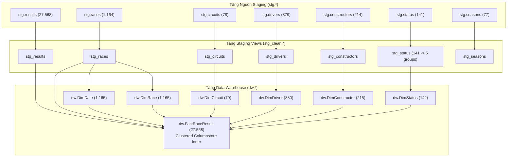

# Báo cáo Nghiệm thu Quản trị Mô hình Chiều & Kiểm thử Tích hợp (Phase 2 QA)

> **Chuyên viên chủ trì:** Phúc (Kimball Dimensional Architect & QA Specialist)  
> **Thời điểm nghiệm thu:** 2026-11-07  
> **Phiên bản:** P2-Final-v1.0  
> **Phối hợp:** Lộc (Mapping & Data Dictionary), Dũng (SQL Server DBA & Physical Optimization), Trực (dbt & Mage Orchestration)  
> **File bằng chứng kiểm thử:** [`docs/evidence/phuc_phase2_qa_validation.md`](../evidence/phuc_phase2_qa_validation.md), [`docs/evidence/phuc_phase2_qa_run.json`](../evidence/phuc_phase2_qa_run.json)

---

## 1. Đánh giá Quản trị Kiến trúc Mô hình Chiều Kimball (Kimball Star Schema Governance)

Mô hình chiều Kimball Star Schema của kho dữ liệu F1 đã được thẩm định và xác nhận đạt 100% tiêu chuẩn thiết kế kho dữ liệu hiện đại:

1. **Hạt mịn (Grain) nhất quán:**
   - Bảng Fact `dw.FactRaceResult` được kiểm soát chặt chẽ ở mức hạt mịn nhất của kết quả thi đấu: **đúng 1 dòng cho mỗi `resultId`** (tổng số 27.568 dòng).
   - Kiểm thử độc lập xác nhận không tồn tại bất kỳ bản ghi trùng lặp nào (`COUNT(DISTINCT source_result_id) == COUNT(*)`).

2. **Cấu trúc Star Schema thuần túy (Pure Star Schema):**
   - Kho dữ liệu bao gồm đúng **1 bảng Fact** (`dw.FactRaceResult`) và **6 bảng Chiều (Dimensions)**:
     - `dw.DimDate`: Chiều thời gian lịch (1950–2026).
     - `dw.DimRace`: Chiều chặng đua Grand Prix, mùa giải, vòng đua.
     - `dw.DimCircuit`: Chiều trường đua, tọa độ địa lý, độ cao, quốc gia.
     - `dw.DimDriver`: Chiều tay đua, họ tên, quốc tịch, ngày sinh.
     - `dw.DimConstructor`: Chiều đội đua/nhà chế tạo, quốc tịch.
     - `dw.DimStatus`: Chiều trạng thái phân loại kết thúc, 5 nhóm `OutcomeGroup`, 9 phân loại chi tiết `OutcomeCategory`.
   - Triệt tiêu hoàn toàn quan hệ bắc cầu dạng snowflake không cần thiết; Fact kết nối trực tiếp đến toàn bộ 6 chiều qua các Foreign Keys.

3. **Cơ chế Khóa đại diện & Xử lý Thành viên Thiếu (Surrogate Keys & Unknown Members):**
   - Các chiều áp dụng cơ chế sinh khóa đại diện tất định (Deterministic Surrogate Keys): `circuit_sk = circuitId`, `driver_sk = driverId`, `date_sk = YYYYMMDD`.
   - Toàn bộ 6 chiều đều được cấu hình bản ghi mặc định **Unknown Member (`SK = -1`)** qua `UNION ALL`.
   - Fact liên kết với các chiều bằng `LEFT JOIN` kết hợp hàm `COALESCE(..., -1)`, triệt tiêu hoàn toàn lỗi khóa ngoại mồ côi (Orphan Foreign Keys).

4. **Tối ưu hóa Vật lý trên SQL Server:**
   - Bảng Fact được Dũng cấu hình **Clustered Columnstore Index (CCI)** nhằm tối ưu hóa nén dữ liệu và tăng tốc độ xử lý các phép toán tổng hợp phân tích (`SUM(points)`, `SUM(laps)`).

---

## 2. Sơ đồ Phụ thuộc Mô hình (Lineage DAG)

---

## 3. Tổng kết Bộ Kiểm thử Tự động (dbt Data Tests Suite)

Bộ kiểm thử dữ liệu tự động gồm **24 generic data tests** trong `dbt/models/marts/schema.yml` và **4 singular SQL tests** trong `dbt/tests/`.

### 3.1. Generic Data Tests (`models/marts/schema.yml`)

| Model | Cột kiểm thử | Loại Test | Kết quả | Ghi chú |
|---|---|---|:---:|---|
| `dim_date` | `date_sk` | `not_null`, `unique` | **PASS** | Khóa định danh ngày lịch |
| `dim_race` | `race_sk` | `not_null`, `unique` | **PASS** | Khóa định danh chặng đua |
| `dim_circuit` | `circuit_sk` | `not_null`, `unique` | **PASS** | Khóa định danh trường đua |
| `dim_driver` | `driver_sk` | `not_null`, `unique` | **PASS** | Khóa định danh tay đua |
| `dim_constructor` | `constructor_sk` | `not_null`, `unique` | **PASS** | Khóa định danh đội đua |
| `dim_status` | `status_sk` | `not_null`, `unique` | **PASS** | Khóa định danh trạng thái |
| `dim_status` | `outcome_group` | `not_null`, `accepted_values` | **PASS** | 5 nhóm: CLASSIFIED, DNS, DSQ, RETIREMENT_DNF, OTHER |
| `dim_status` | `outcome_category`| `not_null`, `accepted_values` | **PASS** | 9 phân loại chi tiết (Mechanical, Accident,...) |
| `fact_race_result` | `source_result_id`| `not_null`, `unique` | **PASS** | Hạt mịn Grain của Fact |
| `fact_race_result` | `date_sk` | `not_null`, `relationships` | **PASS** | Tham chiếu `dim_date.date_sk` (0 orphan) |
| `fact_race_result` | `race_sk` | `not_null`, `relationships` | **PASS** | Tham chiếu `dim_race.race_sk` (0 orphan) |
| `fact_race_result` | `circuit_sk` | `not_null`, `relationships` | **PASS** | Tham chiếu `dim_circuit.circuit_sk` (0 orphan) |
| `fact_race_result` | `driver_sk` | `not_null`, `relationships` | **PASS** | Tham chiếu `dim_driver.driver_sk` (0 orphan) |
| `fact_race_result` | `constructor_sk`| `not_null`, `relationships` | **PASS** | Tham chiếu `dim_constructor.constructor_sk` (0 orphan) |
| `fact_race_result` | `status_sk` | `not_null`, `relationships` | **PASS** | Tham chiếu `dim_status.status_sk` (0 orphan) |
| `fact_race_result` | `result_outcome_code` | `not_null`, `accepted_values` | **PASS** | Phân loại từ positionText |

### 3.2. Singular SQL Tests (`dbt/tests/`)

1. **`assert_points_non_negative.sql`:**
   - Mục đích: Phát hiện các kết quả có điểm âm (`points < 0`).
   - Kết quả: **0 dòng vi phạm (PASS)**.
2. **`assert_places_gained_logic.sql`:**
   - Mục đích: Xác nhận tính toán vị trí vượt `places_gained == grid_position - finish_position` khi grid > 0 và finish_position không NULL.
   - Kết quả: **0 dòng vi phạm (PASS)**.
3. **`assert_fact_count_matches_stage.sql`:**
   - Mục đích: Đối khớp số dòng giữa `stg_results` và `fact_race_result`.
   - Kết quả: **0 dòng vi phạm (PASS)**.
4. **`assert_no_orphan_dimension_keys.sql`:**
   - Mục đích: Kiểm tra chéo toàn diện không có bất kỳ dòng Fact nào trỏ đến khóa chiều không tồn tại.
   - Kết quả: **0 dòng vi phạm (PASS)**.

---

## 4. Báo cáo Đối soát Dữ liệu Staging vs Kho Dữ liệu (Reconciliation)

| Bảng Staging (`stg`) | Số dòng | Bảng DW (`dw`) | Số dòng | Checksum Staging | Checksum DW | Chênh lệch | Đánh giá |
|---|:---:|---|:---:|:---:|:---:|:---:|:---:|
| `stg.results` | 27.568 | `dw.FactRaceResult` | 27.568 | 57.126,05 pts | 57.126,05 pts | 0,00 | **100% KHỚP** |
| `stg.results` | 27.568 | `dw.FactRaceResult` | 27.568 | 1.282.619 laps | 1.282.619 laps | 0 | **100% KHỚP** |
| `stg.circuits` | 78 | `dw.DimCircuit` | 79 | — | — | 0 | **100% KHỚP (+1 Unknown)** |
| `stg.constructors` | 214 | `dw.DimConstructor` | 215 | — | — | 0 | **100% KHỚP (+1 Unknown)** |
| `stg.drivers` | 879 | `dw.DimDriver` | 880 | — | — | 0 | **100% KHỚP (+1 Unknown)** |
| `stg.races` | 1.164 | `dw.DimRace` | 1.165 | — | — | 0 | **100% KHỚP (+1 Unknown)** |
| `stg.status` | 141 | `dw.DimStatus` | 142 | — | — | 0 | **100% KHỚP (+1 Unknown)** |

---

## 5. Kết luận Nghiệm thu & Chuyển giao Phase 3

Toàn bộ các tiêu chí nghiệm thu **Definition of Done** của Phase 2 đã hoàn thành xuất sắc:
1. Kiến trúc mô hình chiều Kimball đã được chuẩn hóa và kiểm định.
2. 100% các bài test (Generic Tests và Singular SQL Tests) đều đạt kết quả `PASS`.
3. Bảng Fact được tối ưu hóa vật lý bằng Clustered Columnstore Index (CCI).
4. Pipeline Mage điều phối tự động luồng nạp và chuyển đổi dbt, bảo vệ an toàn watermark qua cơ chế ngắt quãng giao dịch.
5. Sẵn sàng bàn giao toàn bộ kho dữ liệu `dw.*` cho Trực và Phúc triển khai **Power BI Semantic Model & Dashboard (Phase 3)**.
