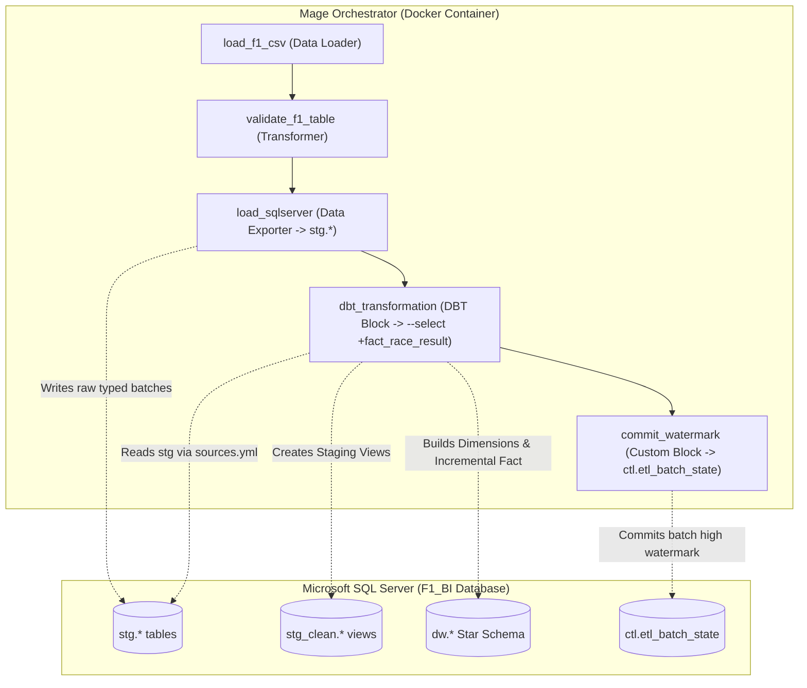

# Runbook Điều phối Pipeline dbt & Mage (Phase 2)

> **Tác giả:** Trực (Data Engineer & dbt-Mage Orchestration Specialist)  
> **Phiên bản:** P2-v1.0 · **Ngày:** 2026-11-07  
> **Tài liệu tham chiếu:** `03_dbt_Mage.docx.pdf`, `03_Appendix_Huong_dan_co_ban_ve_dbt.docx.pdf`, [`stage_to_dw_mapping.md`](../02_data_dictionary_and_mapping/stage_to_dw_mapping.md)  
> **Phối hợp:** Lộc (Mapping & Data Dictionary), Dũng (SQL Server & Columnstore), Phúc (QA & Data Tests)

---

## 1. Tổng quan Kiến trúc Điều phối Mage + dbt Core

Pipeline Phase 2 mở rộng luồng xử lý từ Staging (`stg.*`) sang tầng Data Warehouse phân tích (`dw.*` và `stg_clean.*`), hiện thực hóa mô hình Kimball Star Schema qua dbt Core được điều phối tự động bởi Mage:



### Nguyên tắc Vận hành An toàn & Bền bỉ (Idempotency & Fault Tolerance):
1. **Downstream Watermark Commit:** Block `commit_watermark` bắt buộc nằm sau `dbt_transformation`. Nếu dbt gặp sự cố (ví dụ vi phạm test, lỗi ép kiểu, lỗi kết nối), downstream block bị **ABORTED**, watermark không được ghi nhận trong `ctl.etl_batch_state`.
2. **Chiến lược Incremental Fact (`delete+insert`):** Bảng `dw.FactRaceResult` sử dụng `incremental_strategy='delete+insert'` với khóa duy nhất `source_result_id`. Rerun lại cùng một batch hoặc nạp lại dữ liệu cũ sẽ tự động ghi đè bản ghi trùng khóa mà không làm nhân đôi số dòng.
3. **Deterministic Surrogate Keys:** Các bảng chiều sinh SK trực tiếp từ Natural Key nguồn (`*_sk = source_*_id`, `date_sk = YYYYMMDD`). Khi rebuild các Dimension dạng `materialized='table'`, SK không bị thay đổi, bảo toàn 100% tính toàn vẹn với bảng Fact đã tích lũy từ các batch trước.
4. **Unknown Member Fallback (`SK = -1`):** Mỗi Dimension chứa sẵn 1 bản ghi mặc định `-1` qua `UNION ALL`. Mọi phép join từ Fact đều dùng `LEFT JOIN` và `COALESCE(..., -1)` để triệt tiêu lỗi Orphan Foreign Keys.

---

## 2. Cấu trúc Thư mục dbt Project & Custom Schema Macro

dbt Project được tổ chức tại `./dbt` và mount trực tiếp vào container Mage:

```text
dbt/
├── dbt_project.yml               # Cấu hình project f1_bi và đường dẫn models
├── profiles.yml                  # Thông tin kết nối SQL Server (đọc từ .env)
├── profiles.yml.example          # File mẫu cấu hình profiles
├── requirements.txt              # dbt-sqlserver dependency
├── macros/
│   └── generate_schema_name.sql  # Custom Schema Macro (Appendix trang 2 & 4)
├── models/
│   ├── staging/                  # Schema stg_clean (materialized='view')
│   │   ├── sources.yml           # Khai báo 7 bảng nguồn stg.*
│   │   ├── stg_circuits.sql
│   │   ├── stg_constructors.sql
│   │   ├── stg_drivers.sql
│   │   ├── stg_status.sql        # Phân loại 141 mã status -> 5 outcome_group
│   │   ├── stg_seasons.sql
│   │   ├── stg_races.sql
│   │   └── stg_results.sql
│   └── marts/                    # Schema dw (materialized='table' / 'incremental')
│       ├── schema.yml            # Khai báo metadata và generic data tests
│       ├── dim_date.sql          # Lịch 1950-2026 sinh bằng tally CTE
│       ├── dim_race.sql
│       ├── dim_circuit.sql
│       ├── dim_driver.sql
│       ├── dim_constructor.sql
│       ├── dim_status.sql
│       └── fact_race_result.sql  # Incremental delete+insert
└── tests/                        # Singular SQL Tests
    ├── assert_points_non_negative.sql
    ├── assert_places_gained_logic.sql
    └── assert_fact_count_matches_stage.sql
```

### Chi tiết Macro `macros/generate_schema_name.sql`
Mặc định dbt ghép tiền tố schema target vào tên custom schema (thành `dw_stg_clean` hoặc `dw_dw`). Macro sau ghi đè hành vi để ghi thẳng vào đúng schema `dw` và `stg_clean`:

```jinja

    
        {{ target.schema }}
    
        {{ custom_schema_name | trim }}
    

```

---

## 3. Hướng dẫn Vận hành Pipeline

### 3.1. Khởi động Dịch vụ Docker
```bash
# Khởi chạy Mage và SQL Server network
docker compose up -d

# Kiểm tra container đang hoạt động
docker compose ps
```

### 3.2. Kiểm tra Kết nối dbt CLI trong Mage Container
Truy cập container Mage và chạy kiểm tra:
```bash
docker compose exec mage bash
cd /home/src/project/dbt

# Kiểm tra profile và kết nối SQL Server
dbt debug

# Liệt kê cây phụ thuộc các models
dbt ls --resource-type model --select +fact_race_result
```
*Kết quả kỳ vọng:* Lệnh `dbt debug` báo `All checks passed!`. Lệnh `dbt ls` hiển thị đủ 7 staging models, 6 dimension models và 1 fact model.

### 3.3. Thực thi Transformation & Tests thủ công qua dbt CLI
```bash
# 1. Chạy tầng Staging Views
dbt run --select staging

# 2. Chạy toàn bộ Star Schema (Dimensions + Fact)
dbt run --select +fact_race_result

# 3. Chạy kiểm thử tự động (Generic & Singular Tests)
dbt test --select +fact_race_result
```

### 3.4. Vận hành Điều phối Tự động qua Giao diện Mage UI
1. Mở trình duyệt tại: `http://localhost:6789`.
2. Vào mục **Pipelines** -> chọn pipeline `f1_source_to_stage`.
3. Kiểm tra sơ đồ khối DAG:
   - `load_f1_csv` -> `validate_f1_table` -> `load_sqlserver` -> `dbt_transformation` -> `commit_watermark`.
4. Nhấn **Execute pipeline** hoặc trigger theo lịch.
5. Theo dõi log thời gian thực:
   - Block `load_sqlserver` nạp batch vào `stg.*`.
   - Block `dbt_transformation` gọi `dbt run --select +fact_race_result`, log chi tiết từng model.
   - Block `commit_watermark` cập nhật batch thành công vào `ctl.etl_batch_state`.

---

## 4. Kịch bản Kiểm chứng Tính Bền bỉ (Incremental & Rerun Idempotency)

Theo yêu cầu STT 5 trong kế hoạch, thực hiện 3 kịch bản kiểm tra:

| Kịch bản | Thao tác | Hành vi quan sát | Kết quả nghiệm thu |
|---|---|---|---|
| **1. Baseline Full Load** | Nạp toàn bộ 7 file CSV ban đầu. | Staging có 27.568 dòng results. dbt run tạo 6 Dimensions và Fact có 27.568 dòng. | `dw.FactRaceResult` count = 27.568; 0 orphan FK; SUM(points) khớp Staging 100%. |
| **2. Incremental Batch** | Nạp batch mới (ví dụ nửa sau của chặng đua). | Stage upsert dòng mới; Fact chỉ xử lý các dòng có `_ingested_at_utc` mới. | Số dòng Fact cập nhật chính xác, không scan lại toàn bộ bảng. |
| **3. Rerun Idempotency** | Chạy lại cùng batch vừa nạp mà không đổi dữ liệu. | `unique_key='source_result_id'` thực hiện `DELETE` rồi `INSERT` lại các dòng trùng. | **Tổng số dòng không thay đổi**; không sinh duplicate. |
| **4. Fault Injection** | Giả lập dbt gặp lỗi (cố tình ngắt kết nối hoặc sửa sai model). | Block `dbt_transformation` báo lỗi `FAILED`; block `commit_watermark` bị hủy `ABORTED`. | `ctl.etl_batch_state` giữ nguyên trạng thái chưa commit; cho phép khắc phục và chạy lại an toàn. |

---

## 5. Danh mục Bàn giao Phase 2

- [x] **dbt Project hoàn chỉnh:** `dbt_project.yml`, `profiles.yml.example`, `macros/generate_schema_name.sql`, `models/staging/sources.yml`.
- [x] **7 Staging Models (`stg_clean.*`):** Chuẩn hóa kiểu, loại khoảng trắng, phân loại 5 nhóm `OutcomeGroup` và 9 `OutcomeCategory`.
- [x] **6 Dimensions & 1 Fact (`dw.*`):** Tên bảng PascalCase qua alias, tên cột `snake_case`, tích hợp bản ghi Unknown `-1`, Fact incremental `delete+insert`.
- [x] **Docker & Mage Pipeline:** Mount `./dbt`, cấu hình dependency pipeline theo Figure 1, Appendix dbt.
- [x] **Bộ Kiểm thử dbt Tests:** Generic tests trong `schema.yml` và 3 Singular Tests trong `tests/`.
- [x] **Runbook vận hành:** Hướng dẫn đầy đủ, chi tiết cho đội ngũ vận hành.

