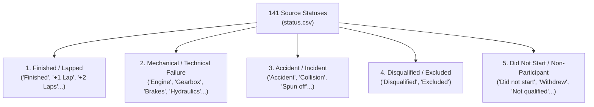

# Business Context, Analytical Requirements, and Data-Use Caveats

> **Document Version:** P4-v1.0 · **Date:** 2026-10-23 · **Owner:** Phúc (Data Source & Profiling) · **Reviewers:** Trực (Dimensional Design & QA), Dũng (SQL Server), Lộc (Mage ETL)

---

## 1. Problem Statement and Business Context

Formula 1 World Championship (1950–2026) is the pinnacle of international motorsport, spanning 77 seasons, over 1,100 Grand Prix events, and tens of thousands of individual race entries. Performance evaluation in Formula 1 involves complex multi-dimensional interactions among drivers, constructors (teams), circuits, and seasons.

A high-performance Business Intelligence (BI) platform is required to support quantitative race analytics, trend evaluations, and strategic post-race reviews. The solution is built for:
- **Performance Analysts & Strategists:** Comparing driver consistency, team dominance eras, qualifying conversion rates, and attrition risks across circuits.
- **Media Analysts & Journalists:** Tracking season championship standings, historical milestone achievements, head-to-head driver comparisons, and anomaly explanations.
- **F1 Enthusiasts & Researchers:** Exploring historical trends across different engine and regulation eras (1950–2026).

### Scope and Boundaries
- **Core Business Process in Scope:** A driver's classified or unclassified race result in an official Grand Prix (grain: `FactRaceResult` at exactly one row per `results.resultId`).
- **Nature of Analysis:** Observational, descriptive, and diagnostic BI. All insights report associations, patterns, and historical statistics from official records. **No causal inferences** (e.g., claiming grid position or circuit layout alone caused an engine failure or accident) are asserted.

---

## 2. Core Business Questions

The analytical model addresses five foundational business questions:

### BQ1: Longitudinal Performance Trends
*How do championship points, race wins, podiums, and classified finishes evolve across seasons for a specific driver or constructor?*
- **Dimensions:** Season (`DimDate`, `DimRace`), Driver (`DimDriver`), Constructor (`DimConstructor`).
- **Target Analysis:** Era comparisons, domination cycles (e.g., Ferrari early 2000s, Mercedes turbo-hybrid 2014–2020, Red Bull 2022–2023), and career progression arcs.

### BQ2: Contribution and Concentration Analysis
*Which drivers and constructors contribute the greatest share of points, wins, and podiums in a selected season, Grand Prix, or circuit?*
- **Dimensions:** Season, Round/Race, Circuit (`DimCircuit`), Constructor, Driver.
- **Target Analysis:** Intra-team teammate battles, constructor dependency on lead drivers, and circuit specialists (e.g., historical performance at Monaco, Monza, or Spa).

### BQ3: Grid-to-Finish Dynamics (Qualifying Conversion)
*How does starting grid position correlate with classified finishing position and points scored, after filtering to valid, classified finishers?*
- **Dimensions:** Circuit, Driver, Constructor, Season.
- **Target Analysis:** Net positions gained/lost (`grid - position`), circuits where overtaking is constrained (low overtaking index vs high qualifying correlation), and rain/chaos impact on grid conversion.

### BQ4: Attrition and Outcome Classification Analysis
*Which specific finishing outcomes (Finished, Accident, Collision, Engine/Mechanical failure, Disqualification, Withdrew, Did Not Start) drive non-classified rates across seasons, constructors, or circuits?*
- **Dimensions:** Outcome Group (`DimStatus`), Constructor, Circuit, Season Era.
- **Target Analysis:** Reliability vs speed trade-offs, mechanical attrition rates across technical regulation changes, and circuit-specific risk profiles (e.g., high retirement rates on street circuits).

### BQ5: Anomaly and Variance Detection
*Which race events, constructors, or drivers exhibit extreme performance spikes or collapses compared to the season rolling baseline or preceding rounds?*
- **Dimensions:** Race event, Circuit, Driver, Constructor.
- **Target Analysis:** Shock podiums/wins in mixed-weather or high-attrition events, double DNFs for top constructors, and sudden constructor point swings.

---

## 3. KPI Definitions, Formulas, and Technical Caveats

All measures are implemented at the `FactRaceResult` grain. Positions and times are **strictly non-additive**; points and laps completed are **additive**.

| KPI | Formal Definition | DAX / SQL Aggregation Logic | Analytical Caveats & Interpretation Rules |
|---|---|---|---|
| **Race Entries (Result Rows)** | Total number of race participation records | `COUNT(FactRaceResult[resultId])` | One row represents one driver in one Grand Prix. This is **not** the number of Grand Prix events. |
| **Total Points** | Total championship points awarded | `SUM(FactRaceResult[points])` | **Crucial Caveat:** Scoring systems changed drastically across eras (e.g., 8-6-4-3-2 in 1950s vs 25-18-15-12-10-8-6-4-2-1 post-2010; fastest lap bonus; sprint points). Direct longitudinal comparisons must compare point shares (%) or rank within era, not raw point sums. |
| **Race Wins** | Total Grand Prix victories | `CALCULATE(COUNTROWS(FactRaceResult), FactRaceResult[positionOrder] = 1)` | Must use `positionOrder = 1` from official classification. Never infer wins from `points > 0` or filter on non-null `position`. |
| **Podiums** | Top-3 race finishes | `CALCULATE(COUNTROWS(FactRaceResult), FactRaceResult[position] IN {1, 2, 3})` | Valid only for classified finishers where `position` is 1, 2, or 3. Unclassified entries (`position IS NULL`) are excluded. |
| **Points per Entry** | Average scoring efficiency | `DIVIDE([Total Points], [Race Entries], 0)` | Denominator and active filters must be displayed to prevent skew from single-entry replacement drivers. |
| **Mean Classified Finish** | Average finishing position | `CALCULATE(AVERAGE(FactRaceResult[position]), NOT(ISBLANK(FactRaceResult[position])))` | **Lower is better.** Calculated strictly across classified finishers. Never substitute NULL unclassified rows with position 20, 99, or 0. |
| **Places Gained (Net Overtakes)** | Starting grid minus finishing position | `CALCULATE(AVERAGE(FactRaceResult[grid] - FactRaceResult[position]), FactRaceResult[grid] > 0, NOT(ISBLANK(FactRaceResult[position])))` | Positive number indicates net positions gained from grid. Filter applied: `grid > 0` (pit-lane starts or unranked grid entries excluded) and `position IS NOT NULL`. |
| **Classified Finish Rate (%)** | Percentage of race entries that completed the race classified | `DIVIDE(CALCULATE(COUNTROWS(FactRaceResult), NOT(ISBLANK(FactRaceResult[position]))), [Race Entries], 0)` | Indicates reliability and race completion probability. |
| **Non-Classified Rate (%)** | Percentage of unclassified entries | `1.0 - [Classified Finish Rate (%)]` | Breakdown by `DimStatus[OutcomeGroup]` required for diagnostic drill-down. |

---

## 4. Status Outcome Grouping Taxonomy

Source table `status.csv` contains 141 distinct statuses. To avoid ad-hoc aggregation errors and maintain semantic integrity, outcomes are standardized into 5 distinct groups in `DimStatus`:

### Critical Status Integrity Rules:
1. **Never merge DNS/DSQ into DNF:** 
   - A driver disqualified (`DSQ`) was disqualified due to technical or sporting infringements.
   - A driver who did not start (`DNS`) never participated in the race laps.
   - Merging these into generic "Did Not Finish" (DNF) distorts team reliability and sporting penalty statistics.
2. **Classified vs Unclassified with Status:**
   - Some cars retired near the end (completing > 90% distance) and are officially *classified* with a finishing `position` (e.g. 15th), even if status reads "Engine" or "Accident".
   - The authoritative criterion for classified finish is `position IS NOT NULL`.

---

## 5. Regulatory and Historical Data-Use Caveats

Any consumer of this BI semantic model (and AI narrative agent) must strictly obey the following data boundaries:

### 5.1 F1 Championship Points Era Incomparability
- **1950–1959:** 8-6-4-3-2 points (only best 4 or 5 results counted toward title; 1 pt for fastest lap).
- **1960:** 8-6-4-3-2-1.
- **1961–1990:** 9-6-4-3-2-1 (various dropped score rules applied).
- **1991–2002:** 10-6-4-3-2-1 (all races counted).
- **2003–2009:** 10-8-6-5-4-3-2-1.
- **2010–Present:** 25-18-15-12-10-8-6-4-2-1 (expanded point depth; bonus point for fastest lap 2019–2024; sprint race points 2021–2026).
- *Mandatory Guideline:* Cross-era driver point totals must never be evaluated without normalizing by max available points per season or presenting career win/podium conversion percentages.

### 5.2 Source Extension Coverage Limitations
- `practice_results.csv`, `weather.csv`, `tire_stints.csv` exist **only for the 2025/2026 seasons** (35 Grand Prix events).
- `lap_times.csv` (632,937 rows) covers **1950–2024 only**; zero records exist for 2025/2026.
- `fastestLapSpeed` in `results.csv` is completely missing (`NULL`) for all 2025/2026 races due to source API upstream limitations.
- *Mandatory Guideline:* Dashboards and queries must not interpret the lack of historical weather or tire data (pre-2025) as zero or clear weather.

### 5.3 Non-Causal Nature of Track and Grid Attributes
- A strong correlation between starting on Pole (`grid = 1`) and winning at Monaco does not imply pole position alone guarantees victory; strategy, safety cars, and mechanical reliability remain confounding factors.
- Reports must frame findings as descriptive likelihoods (e.g., "Historical pole-to-win rate at Monaco is 72%") rather than causal claims.

---

## 6. Dashboard Question Mapping and Visual Hierarchy

### Page 1: Overview Dashboard (Descriptive Analytics)
- **Top Summary Cards:** Total Race Entries, Championship Points, Total Wins, Total Podiums, Classified Finish Rate (%).
- **Season Trajectory Line Chart:** Annual Points, Win %, and Reliability Trend over time with era selectors.
- **Constructor & Driver Leaderboards:** Points and Wins clustered bar chart with intra-team split.
- **Circuit Geo / Distribution Map:** Global Grand Prix locations with bubble size proportional to races hosted.
- **Universal Slicers:** Season Range (1950–2026), Era, Constructor, Driver, Circuit Country.

### Page 2: Detailed / Diagnostic Dashboard (Driver & Reliability Deep Dive)
- **Grid vs. Finish Matrix (Scatter & Deviation Plot):** Starting Grid vs Finishing Position with net gain/loss heatmaps.
- **Reliability Breakdown (Donut & Stacked Bar):** Outcome Group distributions (Mechanical Failure vs Accident vs Finished) filtered by Constructor and Circuit.
- **Event-Level Decomposition (Matrix/Grid):** Race-by-race tabular drill-down with Round, Driver, Grid, Position, Points, Laps, Status, and Place Delta.
- **Anomaly Inspection Callout:** Highlights extreme place gains (e.g., starting P20 and finishing on Podium) with underlying row drill-through.

### Page 3 / AI Module: Verified Generative Explanations
- Generates natural language summaries based strictly on computed DAX measures and visible filter contexts.
- Explicitly states sample sizes, reference baselines, and data limitations (e.g., scoring system changes).
- Declines to generate speculative root-cause explanations if the data shows only unclassified status without telemetry evidence.

---

## 7. Sign-off and Hand-off Alignment

- **Phúc (Author):** Confirms business requirements map 1:1 to validated columns in `docs/source_to_stage_mapping.md`.
- **Trực (Dimensional Model & QA):** Confirms `dw.FactRaceResult` and dimensions satisfy all 5 BQs and KPI DAX requirements without snowflake complexity.
- **Dũng (SQL Server Staging):** Confirms status categories and numeric data types preserve all calculation fidelity.
- **Lộc (Mage ETL):** Confirms null values in position and time measures are properly preserved without zero-padding.
