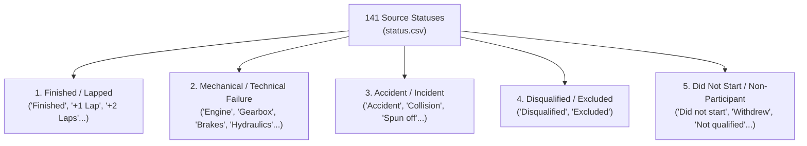

# Business Context, Analytical Requirements, and KPI Contract

> **Document Version:** P4-v1.1 (Merged) · **Date:** 2026-10-23 · **Owners/Contributors:** Phúc (Data Source & Profiling), Trực (Dimensional Design & QA) · **Reviewers:** Dũng (SQL Server), Lộc (Mage ETL)

---

## 1. Problem Statement, Audience, and Business Context

Formula 1 World Championship (1950–2026) is the pinnacle of international motorsport, spanning 77 seasons, over 1,164 Grand Prix events, and tens of thousands of individual race entries. The BI application supports a **Formula 1 performance analyst, team/media analyst, or informed F1 follower** who needs to compare official race outcomes across drivers, constructors, seasons, and circuits.

The business decisions supported include:
- Where and when performance or reliability changed over time.
- Which specific race result entries, drivers, or constructors explain that change.
- How qualifying execution relates to race conversion under different circuit constraints.

### Scope, Grain, and Non-Causal Boundaries
- **Source Scope:** Seven core CSVs documented in [source profile](source_profile.md).
- **Core Business Process & Grain:** Exactly one driver result per Grand Prix (`results.resultId`) in `FactRaceResult`, as defined in [dimensional model](dimensional_model.md). (Laps, pit stops, sprints, practice, and standings require separate grains and are not implied by this contract).
- **Analytical Stance:** Observational, descriptive, and diagnostic BI. The model describes historical statistical associations. **Grid position or circuit characteristics are descriptive factors, not proof of cause** (e.g., accidents or mechanical failures have complex confounding variables).

---

## 2. Core Business Questions (BQ1 – BQ5)

| ID | Business Question | Required Dimensions / Fields | Population & Methodological Criteria |
|---|---|---|---|
| **BQ1** | How do race points, wins, podiums, entries, and classified finishes change by season for a driver or constructor? | `DimRace` (season), `DimDriver`, `DimConstructor`, points, `positionOrder`, `position` | Must show result-entry count and scoring-era caveats alongside points. |
| **BQ2** | Which drivers and constructors contribute the greatest share of points or wins in a selected season, race, or circuit? | `DimRace`, `DimCircuit`, `DimDriver`, `DimConstructor`, points, win flag | State selected filter period, denominator, and result-entry count. |
| **BQ3** | How does starting grid relate to classified finish position and points scored? | `grid`, numeric `position`, points; race/season, driver/constructor, circuit | Include strictly rows with `grid > 0` and valid classified finish (`position IS NOT NULL`); report eligible sample size `n`. Descriptive, not causal. |
| **BQ4** | Which finishing outcomes contribute to non-classified entries by season, constructor, driver, or circuit? | `DimStatus` source label and `OutcomeGroup`, `position`, race and dimensions | Display both exact source status and standardized outcome group. Never merge DNS or DSQ into DNF. |
| **BQ5** | Which race events or circuits exhibit an unusual points/performance change compared to a prior race or season? | Race order, circuit, driver/constructor, points, wins, podiums, classified finish | Name comparison baseline explicitly; expose event-level entries behind change. Never flag anomalies without defined thresholds. |

---

## 3. KPI Definitions, Reproducible Logic, and Caveats

All KPI calculations strictly obey active report filters. Rates and averages are dynamically recomputed from row-level numerators and denominators rather than averaged from displayed subtotals.

| KPI | Formal / Reproducible Definition | DAX / SQL Aggregation Logic | Analytical Caveats & Interpretation Rules |
|---|---|---|---|
| **Result entries** | Total count of race participation records | `COUNT(FactRaceResult[resultId])` | One row represents one driver in one Grand Prix. This is **not** the count of distinct Grand Prix events. |
| **Total points** | Total championship points awarded | `SUM(FactRaceResult[points])` | **Crucial Caveat:** Scoring systems changed drastically across eras (e.g., 8-6-4-3-2 in 1950s; 9-6-4-3-2-1 in 1960s; 10-6-4-3-2-1 in 1990s; 25-18-15... post-2010; fastest lap & sprint points). Raw points across eras are not directly comparable; compare within season/era or use point share (%). |
| **Wins** | Total Grand Prix victories | `CALCULATE(COUNTROWS(FactRaceResult), FactRaceResult[positionOrder] = 1)` | Must use official classification order (`positionOrder = 1`). Never infer from `points > 0` or non-null `position`. |
| **Podiums** | Top-3 race finishes | `CALCULATE(COUNTROWS(FactRaceResult), FactRaceResult[position] IN {1, 2, 3})` | Strictly valid for classified finishers with numeric position 1..3. |
| **Classified entries** | Entries that completed the race classified | `CALCULATE(COUNTROWS(FactRaceResult), NOT(ISBLANK(FactRaceResult[position])))` | Position is official classification. Unclassified entries (`position IS NULL`) excluded. |
| **Points per entry** | Average scoring efficiency | `DIVIDE([Total Points], [Result entries], 0)` | Denominator includes all result entries under active filter (including unclassified). Return blank when denominator is 0. |
| **Mean classified finish** | Average finishing position | `CALCULATE(AVERAGE(FactRaceResult[position]), NOT(ISBLANK(FactRaceResult[position])))` | **Lower is better.** Strictly over classified finishes. Never replace NULL unclassified rows with 0, 20, or 99. |
| **Grid-to-finish places gained** | Net positions gained/lost from start | `CALCULATE(AVERAGE(FactRaceResult[grid] - FactRaceResult[position]), FactRaceResult[grid] > 0, NOT(ISBLANK(FactRaceResult[position])))` | Positive = gained, zero = held, negative = lost. Strictly require `grid > 0` and classified finish. Report eligible count `n`. |
| **Non-classified rate (%)** | Share of non-classified results | `DIVIDE(CALCULATE(COUNTROWS(FactRaceResult), ISBLANK(FactRaceResult[position])), [Result entries], 0)` | Report numerator, denominator, and outcome group breakdown. |
| **Contribution share (%)** | Member KPI divided by parent total | `DIVIDE([Member KPI], [Parent Context KPI], 0)` | Explicitly state parent population (e.g. constructor points / season points). Do not divide by unfiltered global total. |

If a source numeric field cannot be parsed, keep the source row, record a conversion discrepancy, and exclude the invalid value from that KPI until resolved. Preserve SQL NULL separately from zero and empty string.

---

## 4. Status Outcome Grouping Taxonomy

Source table `status.csv` contains 141 distinct statuses. To avoid ad-hoc aggregation errors and maintain semantic integrity, outcomes are standardized into 5 distinct groups in `DimStatus`:

### Critical Status Integrity Rules:
1. **Never merge DNS/DSQ into DNF:**
   - Disqualified (`DSQ`): excluded due to sporting/technical regulation infringement.
   - Did Not Start (`DNS`): vehicle never crossed start line to participate.
   - Merging these into generic "Did Not Finish" (DNF) distorts mechanical reliability vs sporting penalty statistics.
2. **Classified vs Unclassified with Status:**
   - Cars retiring after completing >90% race distance are officially *classified* with a finishing `position` (e.g. 14th) even if their status is "Engine" or "Accident".
   - The authoritative criterion for classified finish is `position IS NOT NULL`.

---

## 5. Regulatory and Historical Data-Use Caveats

Any consumer of this BI semantic model (and AI narrative agent) must strictly obey the following data boundaries:

### 5.1 F1 Championship Points Era Incomparability
- **1950–1959:** 8-6-4-3-2 points (only best 4 or 5 results counted toward title; 1 pt for fastest lap).
- **1960:** 8-6-4-3-2-1.
- **1961–1990:** 9-6-4-3-2-1 (various dropped score rules applied).
- **1991–2002:** 10-6-4-3-2-1 (all races counted).
- **2003–2009:** 10-8-6-5-4-3-2-1.
- **2010–Present:** 25-18-15-12-10-8-6-4-2-1 (expanded point depth; bonus point for fastest lap 2019–2024; sprint race points 2021–2026).
- *Mandatory Guideline:* Cross-era driver point totals must never be evaluated without normalizing by max available points per season or presenting career win/podium conversion percentages.

### 5.2 Source Extension Coverage Limitations
- `practice_results.csv`, `weather.csv`, `tire_stints.csv` exist **only for 2025/2026 seasons** (35 Grand Prix events).
- `lap_times.csv` (632,937 rows) covers **1950–2024 only**; zero records exist for 2025/2026.
- `fastestLapSpeed` in `results.csv` is completely missing (`NULL`) for all 2025/2026 races due to source API upstream limitations.
- *Mandatory Guideline:* Dashboards and queries must not interpret the lack of historical weather or tire data (pre-2025) as zero or clear weather.

### 5.3 Non-Causal Nature of Track and Grid Attributes
- A strong correlation between starting on Pole (`grid = 1`) and winning at Monaco does not imply pole position alone guarantees victory; strategy, safety cars, and mechanical reliability remain confounding factors.
- Reports must frame findings as descriptive likelihoods (e.g., "Historical pole-to-win rate at Monaco is 72%") rather than causal claims.

---

## 6. Dashboard Question Mapping and Visual Hierarchy

### Dashboard 1: Overview (Descriptive Analytics)
- **Top Summary Cards:** Total Race Entries, Championship Points, Total Wins, Total Podiums, Classified Entries, Non-Classified Rate (%). State selected period and non-classified numerator/denominator.
- **Season Trajectory Line Chart:** Annual Points, Win %, and Reliability Trend over time with era selectors and scoring caveats.
- **Constructor & Driver Leaderboards:** Points and Wins clustered bar chart with intra-team split within selected season.
- **Circuit Geo / Distribution Map:** Global Grand Prix locations with bubble size proportional to races hosted, entries, and outcomes.
- **Universal Slicers:** Season Range (1950–2026), Race/Round, Constructor, Driver, Circuit/Country, and Status Outcome Group.

### Dashboard 2: Detailed / Diagnostic (Driver & Reliability Deep Dive)
- **Drill Hierarchy:** Drill from season to round/race, and from constructor to driver; drill-through to a result-row detail view keyed by source `resultId`.
- **Grid vs. Finish Matrix (Scatter & Deviation Plot):** Starting Grid vs Finishing Position with net gain/loss heatmaps for the eligible population (`grid > 0`, classified), exposing excluded counts.
- **Reliability Breakdown (Donut & Stacked Bar):** Outcome Group distributions (Mechanical Failure vs Accident vs Finished) filtered by Constructor and Circuit with exact row counts.
- **Event-Level Decomposition (Matrix/Grid):** Race-by-race tabular drill-down with Round, Driver, Grid, Position, Points, Laps, Status, and Place Delta.
- **Anomaly Inspection Callout:** Highlights extreme place gains with underlying row drill-through.
- **Reconciliation View:** Inspection for a selected race/driver/constructor with source IDs, source measures, status label, and derived values (Phase 2 requirement).

### AI Analytics Module: Verified Generative Explanations
- Generates natural language summaries based strictly on computed DAX measures and visible filter contexts.
- Explicitly states sample sizes, reference baselines, and data limitations (e.g., scoring system changes).
- Declines to generate speculative root-cause explanations if the data shows only unclassified status without telemetry evidence.

---

## 7. Quantitative Evidence for Acceptance and Report

For the diagnostic page/report, retain evidence for:
1. Source and Stage counts for all seven core tables, plus the selected result count;
2. One sampled race and driver/constructor traced from `results.csv` through `stg.results`, including source IDs, optional NULL fields, and ETL run/batch log;
3. Points and result-entry contribution by status group, constructor, and circuit for a stated season/race selection;
4. Grid-to-finish sample size, the exact eligibility predicate, and a small set of row-level examples;
5. Numerator/denominator for every displayed rate, and the comparison period used for every change explanation.

Phase 1 defines these evidence needs and SQL acceptance checks. Actual pipeline evidence remains pending until the Stage loader is integrated and run.

---

## 8. Traceability to Course Project Requirements

| Requirement | Contract Contribution | Delivery Phase |
|---|---|---|
| **3.1 Mage Ingestion into Staging**; validation, full/incremental load, status/count/error logging, rerun | Operational ETL requirement; mapping and null-token rules defined in [source-to-stage mapping](source_to_stage_mapping.md) | Phase 1 |
| **3.2 dbt transformations**; cleaning, standardization, integration, tests, dependencies, docs | Lineage, natural-key, and relationship tests defined in [dimensional model](dimensional_model.md) | Phase 2 |
| **3.3 SQL Server DW**; business process/grain, fact/dimensions/measures, star schema | One-fact star-schema contract (`FactRaceResult` at grain `resultId`) | Design Phase 1; Implementation Phase 2 |
| **3.4 Semantic Model & Dashboards**; relationships, DAX, hierarchies, 2 dashboards | KPI definitions, status grouping taxonomy, drill/filter behavior, and diagnostic evidence above | Phase 2 |
| **3.5 AI Summary & Explanation**; grounded in measures and verifiable | Explicit requirement to cite active filters, period, baseline, visible KPIs, and state when evidence is insufficient | Phase 3 / Final Delivery |

---

## 9. Sign-off and Hand-off Alignment

- **Phúc (Author):** Confirms business requirements map 1:1 to validated columns in `docs/source_to_stage_mapping.md`.
- **Trực (Dimensional Model & QA):** Confirms `dw.FactRaceResult` and dimensions satisfy all 5 BQs and KPI DAX requirements without snowflake complexity.
- **Dũng (SQL Server Staging):** Confirms status categories and numeric data types preserve all calculation fidelity.
- **Lộc (Mage ETL):** Confirms null values in position and time measures are properly preserved without zero-padding.
