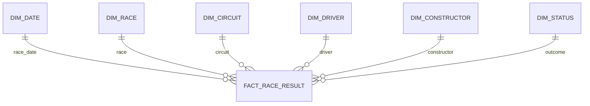

# Dimensional model contract

This is the Phase 1 design contract for the Phase 2 warehouse implementation. It defines one business process and one core fact grain. It does not claim that `dw.*` or dbt models have been implemented.

## Business process and grain

**Business process:** an official driver's race result in a Formula 1 Grand Prix.

**Fact grain:** exactly one row for each source `results.resultId`. The source result ID is the natural key and must be unique. A race result is not a lap, pit stop, sprint result, or championship-standing snapshot. Those are separate business processes with different grains and are outside this fact.

The fact originates from `stg.results`. A result row is retained when optional measures such as `position`, `time`, `milliseconds`, or fastest-lap fields are NULL. A missing result or dimension match must be reported; it must not silently remove a source result.

## Star schema

Every dimension has a generated integer surrogate key, retains its source natural key as an alternate key, and relates one-to-many to `FactRaceResult`. Use a reserved `Unknown` member (for example, surrogate key `-1`) when a dimension value is genuinely unavailable. Do not use that member to hide an orphan source key.

| Target | Grain and key contract | Attributes and hierarchy |
|---|---|---|
| `dw.FactRaceResult` | One row per `results.resultId`; primary key `RaceResultSK`; unique alternate key `SourceResultId` | Dimension FKs `DateSK`, `RaceSK`, `CircuitSK`, `DriverSK`, `ConstructorSK`, `StatusSK`; retain source `resultId`, `raceId`, `driverId`, `constructorId`, and `statusId` for lineage and reconciliation; source measures and derived flags below |
| `dw.DimDate` | One row per calendar date; generated `DateSK` | Calendar date, day, month number/name, quarter, year, weekday; hierarchy Year -> Quarter -> Month -> Day. Race date comes from `races.date`. |
| `dw.DimRace` | One row per source `races.raceId`; generated `RaceSK`, alternate key `SourceRaceId` | Season year, round, official race name; hierarchy Year/Season -> Round -> Race. |
| `dw.DimCircuit` | One row per `circuits.circuitId`; generated `CircuitSK`, alternate key `SourceCircuitId` | Circuit name, locality, country, latitude, longitude, altitude; hierarchy Country -> Circuit. `alt = 0` may be a source placeholder for newer circuits. |
| `dw.DimDriver` | One row per `drivers.driverId`; generated `DriverSK`, alternate key `SourceDriverId` | Full name, code, permanent number, nationality, date of birth; hierarchy Nationality -> Driver where useful. Missing historical code/number/DOB stays NULL. |
| `dw.DimConstructor` | One row per `constructors.constructorId`; generated `ConstructorSK`, alternate key `SourceConstructorId` | Historical constructor name and nationality; hierarchy Nationality -> Constructor where useful. Keep the source name rather than rewriting historical team names. |
| `dw.DimStatus` | One row per `status.statusId`; generated `StatusSK`, alternate key `SourceStatusId` | Keep the exact source label and add the derived `OutcomeGroup` below. |

The fact receives `DateSK` from the race date, `RaceSK` from `results.raceId`, `CircuitSK` from that race's `circuitId`, and the remaining keys from the source driver, constructor, and status IDs. `DimRace` carries season and round for race navigation; `DimCircuit` is a separate conformed filter. Keep relationships single-direction from each dimension to the fact in the semantic model. Use `DimRace` as the authoritative season/round/race hierarchy and `DimDate` for calendar analysis; do not create a second filter path between dimensions.

### Status outcome groups

Keep `statusId` and the raw `status` label unchanged. `OutcomeGroup` is a separate analytical attribute with this proposed mapping:

| Group | Source labels/rule |
|---|---|
| `CLASSIFIED` | `Finished`, `Lapped`, and labels of the form `+N Lap` / `+N Laps` |
| `DNS` | `Did not start`, `Withdrew` |
| `DSQ` | `Disqualified`, `Excluded`, `Underweight` (confirm with the analyst before publishing) |
| `RETIREMENT_DNF` | Known accident, mechanical, damage, medical, or retirement labels from `status.csv`; retain the exact label for detail |
| `OTHER` | `Not classified`, `Did not qualify`, `Did not prequalify`, `107% Rule`, `Not restarted`, and any unrecognized future label until reviewed |

The mapping is a draft for the current source snapshot and needs analyst review. A numeric `position` determines whether a result has a classified finish; the outcome group explains the source status and must not override that value. A mismatch between the source status group and numeric position is a discrepancy to review.

This is a star schema: descriptive attributes are kept in their dimensions and each dimension joins directly to the fact. No snowflake split is needed for Phase 1. Normalize only if Phase 2 identifies a concrete reuse or maintenance reason and documents the changed relationship path.

## Measures and aggregation rules

| Source or derived field | Semantic measure | Aggregation and population |
|---|---|---|
| `results.points` | Points | Additive at result grain. Sum under the active filters; raw totals across seasons/eras are not directly comparable because scoring rules changed. |
| `results.laps` | Laps completed | Additive only as driver-result laps; label it clearly and do not present it as unique race laps. |
| Constant `1` | Result entries | Additive row count. One entry is one `resultId`, not one race. |
| `positionOrder = 1` | Wins | Additive win flag/count using the source order field. Do not infer a win from NULL `position`. |
| Numeric `position` from 1 through 3 | Podiums | Additive flag/count for classified finishes only. |
| `results.grid` | Grid position | Non-additive. Average/median only with an explicit valid-grid population; `0` is not a valid start position for grid-to-finish analysis. |
| `results.position` | Finish position | Non-additive. Average/median only for numeric classified positions; lower is better. NULL is not a position. |
| `grid - position` | Places gained | Derived per row only when `grid > 0` and `position` is a positive numeric classified finish. Positive means gained places. Report eligible row count with the statistic. |
| `results.milliseconds`, `time`, fastest-lap time/speed | Time/speed measures | Non-additive. Keep NULL when unavailable; compare only with a documented population and compatible time meaning. Never sum them. |
| `position IS NULL` | Non-classified entry flag | Derive at row level for the non-classified rate. Do not substitute `OutcomeGroup` for this test; show the status breakdown alongside it. |

Rates and averages must be recomputed from their numerator and denominator in the active filter context. Do not average pre-aggregated percentages or sum positions, speed, or time. `statusId` is mandatory for the source fact contract; an unknown status label stays in `OTHER` until reviewed and is exposed as a quality finding.

## Source lineage and Phase 2 tests

| Target | Source |
|---|---|
| `FactRaceResult` | `stg.results` |
| `DimDate`, `DimRace` | `stg.races`; `stg.seasons` supports season coverage validation |
| `DimCircuit` | `stg.circuits` |
| `DimDriver` | `stg.drivers` |
| `DimConstructor` | `stg.constructors` |
| `DimStatus` | `stg.status` plus the reviewed mapping contract |

Phase 2 dbt work must document model dependencies and test dimension natural-key uniqueness/not-null, fact `SourceResultId` uniqueness/not-null, all fact-to-dimension relationships, and outcome-group coverage. Source NULLs remain NULL through staging and cleaning unless a documented business rule derives a separate field.
