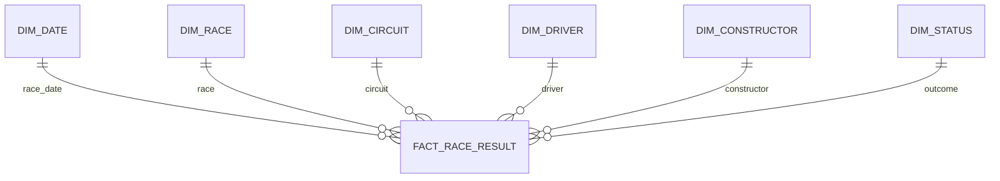

# Dimensional model design target

This is the Phase 1 design contract; implementation and dbt loading into SQL Server `dw` are later project work. Use one core fact at one explicit grain. Add another fact only if the group adds a separate business process with its own grain.

## Business process and grain

Business process: a driver's official race result in a Grand Prix. Grain: exactly one row per source `results.resultId` in `FactRaceResult`. This grain prevents accidental duplication when driver, constructor, circuit, status, and date attributes are joined.

## Star schema

| Table | Key and attributes | Notes |
|---|---|---|
| `dw.FactRaceResult` | Surrogate fact key or source `resultId`; foreign keys to all dimensions; source result ID | One row per resultId; preserve source IDs for lineage |
| `dw.DimDate` | DateSK; date, day, month, quarter, year, weekday | Hierarchy year -> quarter -> month -> day |
| `dw.DimRace` | RaceSK, source raceId; year, round, official race name | Hierarchy season/year -> round -> race |
| `dw.DimCircuit` | CircuitSK, source circuitId; circuit, locality, country, lat/lng, altitude | Drill from country to circuit; alt may be placeholder 0 |
| `dw.DimDriver` | DriverSK, source driverId; full name, code, number, nationality, DOB | Drill from nationality to driver where useful |
| `dw.DimConstructor` | ConstructorSK, source constructorId; name and nationality | Keep historical source names as provided |
| `dw.DimStatus` | StatusSK, source statusId; source label and approved outcome group | Group mapping must be reviewable and retain source status |

Each dimension has a generated integer surrogate key. Keep source natural keys as alternate keys for matching and traceability. Dimension-to-fact relationships are one-to-many. In `FactRaceResult`, retain source `resultId` and source foreign keys for reconciliation. If a required dimension key is missing, design an explicit Unknown member rather than dropping the result.

## Facts, measures and aggregation rules

| Source attribute / derived value | Target | Aggregation |
|---|---|---|
| `points` | Points | Additive; sum by driver/team/race/season |
| `laps` | LapsCompleted | Additive only at the result grain and clearly labeled |
| Constant 1 per result | ResultCount | Additive count of entries |
| `positionOrder = 1` | WinFlag | Sum to count wins |
| valid `position` in 1..3 | PodiumFlag | Sum to count podiums |
| `grid`, classified `position` | GridPosition, FinishPosition | Non-additive; average/median only with explicit validity filters |
| `grid - position` | PlacesGained | Derived only for positive grid and valid classified finish |
| `milliseconds` | RaceMilliseconds | Non-additive and NULL when unavailable; only compare with a defined population |

Do not sum positions, speed, race time, or fastest-lap time. Build the status-group mapping from source labels and record the classification rule so that an unclassified result, retirement, DNS, and disqualification remain distinguishable.

## Source to model lineage

`FactRaceResult` originates from `stg.results`; `DimDate`/`DimRace` from `stg.races` and `stg.seasons`; `DimCircuit` from `stg.circuits`; `DimDriver` from `stg.drivers`; `DimConstructor` from `stg.constructors`; and `DimStatus` from `stg.status`. dbt models will clean types/NULLs, apply surrogate keys, test uniqueness and relationships, and expose the documented model dependencies before the Power BI semantic model is built.
