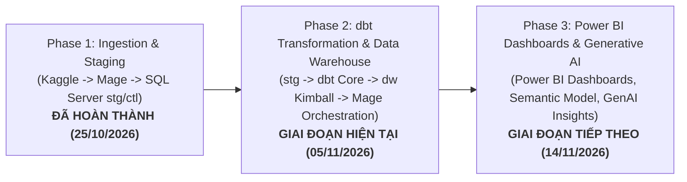

# Lộ trình & Kế hoạch Thực hiện Dự án MiniProject BI

**Học phần:** Business Intelligence / Data Warehouse  
**Bộ dữ liệu:** Formula 1 World Championship (1950–2026)  
**Nhóm sinh viên thực hiện:** Phúc, Dũng, Lộc, Trực  

---

## Tổng quan Lộ trình Dự án (Project Milestones)

Dự án được chia làm 3 giai đoạn (Phases) kế thừa chặt chẽ theo chu trình phát triển Data Warehouse & Business Intelligence chuẩn công nghiệp:



---

## Cấu trúc Thư mục Kế hoạch (`plans/`)

Nhằm đảm bảo tính chuyên nghiệp, dễ theo dõi và bàn giao qua từng giai đoạn, toàn bộ kế hoạch được tổ chức thành các thư mục phase riêng biệt, mỗi phase chia thành kế hoạch tổng thể và kế hoạch chi tiết cho từng thành viên:

```text
plans/
├── README.md                                         # Tài liệu tổng quan lộ trình (File này)
│
├── phase1_etl_staging/                               # Phase 1: Ingestion & Staging (Đã nghiệm thu)
│   ├── 00_ke_hoach_tong_quat_phase1.md               # Kế hoạch tổng quát Phase 1 (Mage + SQL Server Stage)
│   ├── 01_ke_hoach_phuc_source_profile.md            # Kế hoạch chi tiết Phúc: Source profiling & data contract
│   ├── 02_ke_hoach_dung_sqlserver_staging.md         # Kế hoạch chi tiết Dũng: SQL Server setup & DDL staging
│   ├── 03_ke_hoach_loc_mage_etl.md                   # Kế hoạch chi tiết Lộc: Xây dựng pipeline Mage ETL & tests
│   └── 04_ke_hoach_truc_model_qa.md                  # Kế hoạch chi tiết Trực: Thiết kế dimensional & QA
│
└── phase2_dbt_dw/                                    # Phase 2: dbt Transformation & Data Warehouse (Hiện tại)
    ├── 00_ke_hoach_tong_quat_phase2.md               # Kế hoạch tổng quát Phase 2 (dbt, Kimball DW, Mage, QA)
    ├── 01_ke_hoach_loc_transformation_mapping.md     # Kế hoạch chi tiết Lộc: Ánh xạ chuyển đổi & từ điển DW (25đ)
    ├── 02_ke_hoach_dung_sqlserver_dw.md              # Kế hoạch chi tiết Dũng: Quản trị SQL Server, Columnstore & Seed (25đ)
    ├── 03_ke_hoach_truc_dbt_mage_etl.md              # Kế hoạch chi tiết Trực: Lập trình dbt models & điều phối Mage (25đ)
    └── 04_ke_hoach_phuc_dimensional_qa.md            # Kế hoạch chi tiết Phúc: Quản trị Kimball & bộ dbt tests (25đ)
```

---

## Ma trận Phân công Công việc Cân bằng (25 điểm / thành viên)

| Thành viên | Trách nhiệm chính trong Phase 1 (Đã hoàn thành) | Trách nhiệm chính trong Phase 2 (Đang triển khai) | Điểm Phase 2 |
|---|---|---|:---:|
| **Lộc** | Xây dựng pipeline Mage ETL, xử lý NULL `\N`, Full/Incremental load, cơ chế ghi log vào `ctl`. | Thẩm định chi tiết logic biến đổi từ `stg` sang `dw` (phân loại 141 mã status thành 5 nhóm `OutcomeGroup`, quy tắc xử lý điểm số các thời kỳ F1), xây dựng từ điển dữ liệu DW và soạn thảo tài liệu Phase 2. | **25** |
| **Dũng** | Cài đặt SQL Server, cấp phát user, viết DDL 7 bảng Staging (`stg`) và bảng Control (`ctl`). | Thiết lập vật lý schema Data Warehouse (`dw`), cấp phát quyền, áp dụng **Clustered Columnstore Index (CCI)** cho Fact, tạo bản ghi mặc định **Unknown Member (`SK = -1`)**, viết script SQL đối soát toàn diện (`stg` vs `dw`). | **25** |
| **Trực** | Định hình grain, thiết kế Star Schema logic, quy chuẩn KPI và kiểm thử đối soát Phase 1. | Thiết kế và lập trình **dbt project** (7 Staging views, 6 Dimensions, 1 Incremental Fact, macro `generate_schema_name`). Nâng cấp Docker và tích hợp DBT Model block vào pipeline điều phối Mage. | **25** |
| **Phúc** | Profile 17 CSV nguồn, xác định missing value, lập source mapping và data quality contract. | Quản trị thiết kế mô hình chiều Kimball (Grain 1 dòng/`resultId`), xây dựng bộ **dbt Data Tests** tự động (`schema.yml` + singular SQL tests), thực thi 4 kịch bản thử nghiệm nạp/chạy lại/sự cố và nghiệm thu Phase 2. | **25** |

---

## Chi tiết các Tài liệu Kế hoạch Phase 2

Nhấn vào từng file bên dưới để xem kế hoạch hành động chi tiết của từng thành viên:
1. [Kế hoạch tổng quát Phase 2](phase2_dbt_dw/00_ke_hoach_tong_quat_phase2.md)
2. [Kế hoạch chi tiết: Lộc - Transformation Mapping & Semantic QA](phase2_dbt_dw/01_ke_hoach_loc_transformation_mapping.md)
3. [Kế hoạch chi tiết: Dũng - SQL Server DW Physical & Optimization](phase2_dbt_dw/02_ke_hoach_dung_sqlserver_dw.md)
4. [Kế hoạch chi tiết: Trực - dbt Models & Mage Orchestration](phase2_dbt_dw/03_ke_hoach_truc_dbt_mage_etl.md)
5. [Kế hoạch chi tiết: Phúc - Kimball Architecture & QA Acceptance](phase2_dbt_dw/04_ke_hoach_phuc_dimensional_qa.md)
