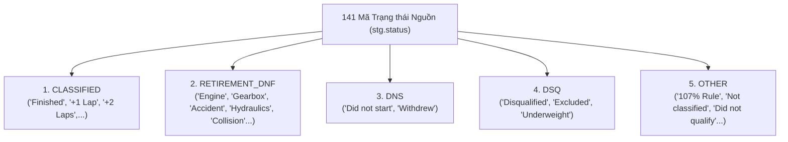

# Kế hoạch Cá nhân Phase 2: Transformation Mapping & Semantic QA

**Thành viên:** Lộc  
**Vai trò:** Transformation Mapping, F1 Domain & Data Dictionary Specialist  
**Điểm tải công việc:** **25 điểm**  
**Thời hạn hoàn thành:** Mốc từng phần từ 28/10 đến 04/11/2026; nghiệm thu trước 23:00 ngày 05/11/2026  
**Phối hợp với:** Trực (bàn giao bảng mapping để Trực viết dbt SQL), Dũng (nhận schema metadata), Phúc (nghiệm thu QA)

---

## 1. Mục tiêu & Trách nhiệm của Lộc trong Phase 2

Trong Phase 2, dữ liệu đã nằm an toàn trong schema `stg` trên SQL Server. Trách nhiệm của Lộc là:
1. **Thiết lập Bảng Ánh xạ Chuyển đổi Chi tiết (Stage-to-DW Transformation Mapping):** Xác định chính xác từng trường từ `stg` sẽ được CAST kiểu, TRIM chuỗi, gán nhãn nghiệp vụ và ánh xạ vào các trường của `dw`.
2. **Quy chuẩn Ánh xạ 141 Trạng thái Đua (`OutcomeGroup`):** Chuẩn hóa 141 mã status thành 5 nhóm lớn để phục vụ phân tích độ tin cậy và sự cố.
3. **Quy chuẩn Ngữ nghĩa Thước đo F1 (Measures & Era Rules):** Thẩm định logic điểm số qua các thời kỳ F1 (1950–2026) để bảo đảm việc tính toán các measure tổng hợp không bị sai lệch lịch sử.
4. **Biên soạn Từ điển Dữ liệu Kho (Data Warehouse Data Dictionary):** Tài liệu hóa chi tiết toàn bộ các cột, kiểu dữ liệu, ý nghĩa nghiệp vụ và ràng buộc trong schema `dw`.
5. **Đồng biên soạn Báo cáo Kỹ thuật Phase 2:** Tổng hợp phần bối cảnh, quy tắc chuyển đổi dữ liệu và đánh giá chất lượng cho báo cáo đồ án.

---

## 2. Phân rã Công việc & Điểm số (25 Điểm)

| STT | Nhiệm vụ chi tiết | Điểm | Hạn chót | Tiêu chí nghiệm thu |
|:---:|---|:---:|:---:|---|
| **1** | **Xây dựng Bảng Ánh xạ Chuyển đổi Staging -> Marts** Xác định quy tắc chuyển đổi cho 7 bảng: tên cột mới, kiểu dữ liệu đích, hàm xử lý (TRIM, COALESCE, CAST, CONCAT). | **6** | 28/10 | Bàn giao tài liệu mapping cho Trực để viết các model `stg_*.sql` và `dim_*.sql`. Không còn trường nào chưa rõ kiểu. |
| **2** | **Hoàn thiện Quy tắc Phân nhóm Trạng thái (`OutcomeGroup`)** Phân loại chi tiết 141 mã status từ `stg.status` vào đúng 5 nhóm: `CLASSIFIED`, `DNS`, `DSQ`, `RETIREMENT_DNF`, `OTHER`. Xử lý trường hợp xe chạy > 90% quãng đường vẫn có vị trí phân hạng. | **6** | 29/10 | Bảng ánh xạ 141 dòng được kiểm duyệt, không để sót bất kỳ trạng thái nào vào `OTHER` vô lý; Trực ứng dụng trực tiếp vào `stg_status.sql`. |
| **3** | **Đặc tả Quy tắc Nghiệp vụ Điểm số & Độ đo F1** Tài liệu hóa quy định tính điểm F1 theo từng kỷ nguyên (1950–1959: 8-6-4-3-2; 1960: 8-6-4-3-2-1; 1961–1990: 9-6-4-3-2-1; 1991–2009: 10 điểm; 2010–nay: 25 điểm). Xác nhận công thức tính `places_gained = grid - position`. | **4** | 31/10 | Bản đặc tả quy chuẩn measure; xác nhận công thức `places_gained` chỉ hợp lệ khi `grid > 0` và `position` không NULL. |
| **4** | **Biên soạn Từ điển Dữ liệu Data Warehouse (DW Data Dictionary)** Mô tả chi tiết 1 Fact (`FactRaceResult`) và 6 Dimensions (`DimDate`, `DimRace`, `DimCircuit`, `DimDriver`, `DimConstructor`, `DimStatus`): tên cột, kiểu dữ liệu, ý nghĩa, ví dụ mẫu. | **5** | 02/11 | Tài liệu hoàn chỉnh được lưu tại `docs/02_data_dictionary_and_mapping/dw_data_dictionary.md`. |
| **5** | **Thẩm định Đối soát Dữ liệu Đầu ra & Đồng tác giả Báo cáo** Đối chiếu dữ liệu đầu ra của dbt với dữ liệu nguồn; đồng tác giả báo cáo Phase 2 phần Data Transformation & Modeling. | **4** | 05/11 | Không có sai lệch giữa nghiệp vụ và dữ liệu trong `dw`; hoàn thiện các mục báo cáo được phân công. |

---

## 3. Chi tiết Bảng Ánh xạ Phân nhóm Trạng thái F1 (`OutcomeGroup`)

141 mã trạng thái nguồn trong `stg.status` được Lộc phân loại vào 5 nhóm phân tích chiến lược:

### Nguyên tắc Nghiệp vụ Bắt buộc:
1. **Không gộp DNS và DSQ vào DNF:**
   - DNS (Did Not Start): Xe không xuất phát (không tham gia chặng đua thực tế).
   - DSQ (Disqualified): Bị loại do vi phạm kỹ thuật hoặc luật thi đấu thể thao.
   - DNF (Did Not Finish / Retirement): Xuất phát nhưng phải bỏ cuộc do sự cố cơ học hoặc tai nạn.
2. **Ưu tiên giá trị phân hạng chính thức:**
   - Nếu một tay đua bỏ cuộc ở những vòng cuối (đã hoàn thành trên 90% cự ly đua), theo luật F1 họ vẫn được xếp hạng chính thức (`position IS NOT NULL`). Thuộc tính `OutcomeGroup` chỉ giải thích lý do kết thúc, không được ghi đè quy tắc phân hạng.

---

## 4. Các Giao diện Phối hợp & Bàn giao

- **Bàn giao cho Trực:**
  - Logic phân loại `OutcomeGroup` để Trực viết lệnh `CASE WHEN` trong `dbt/models/staging/stg_status.sql`.
  - Quy tắc ép kiểu và công thức dẫn xuất (`full_name`, `is_win`, `is_podium`, `places_gained`) để đưa vào `stg_results.sql` và `fact_race_result.sql`.
- **Bàn giao cho Dũng:**
  - Danh mục các giá trị cần seed cho bản ghi Unknown (`SK = -1`) trên các bảng chiều.
- **Bàn giao cho Phúc:**
  - Danh sách các giá trị hợp lệ (`accepted_values`) cho `OutcomeGroup` để đưa vào kiểm thử tự động `dbt test`.
