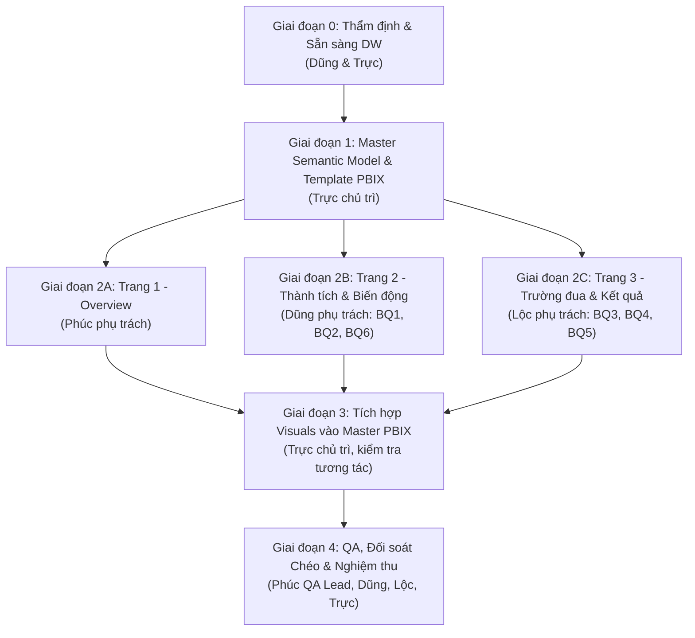

# Kế hoạch Triển khai Power BI - Phase 3: Semantic Model & Dashboard Báo cáo Formula 1

**Học phần:** Data Warehouse & Business Intelligence  
**Đồ án:** Formula 1 Analytics (1950–2026)  
**Nhóm sinh viên thực hiện:** Phúc, Dũng, Lộc, Trực  
**Phạm vi Phase 3:** Xây dựng Semantic Model chuẩn trên Power BI Desktop kết nối SQL Server Data Warehouse (`dw`), phát triển 3 trang Dashboard chuyên sâu, quản trị tập trung DAX measures, tích hợp file PBIX duy nhất và nghiệm thu chất lượng trực quan hóa.

---

## 1. Đánh giá Hiện trạng Kho Dữ liệu (DW/dbt Readiness Check)

Theo nguyên tắc quản trị kỹ thuật, nhóm không giả định Data Warehouse đã sẵn sàng mà tiến hành rà soát thực tế mã nguồn, schema vật lý và trạng thái nạp dữ liệu.

### 1.1. Kết quả Rà soát Cấu trúc dbt & Schema Data Warehouse
Dựa trên mã nguồn tại [`dbt/models/marts/`](../../dbt/models/marts/) và Từ điển dữ liệu [`dw_data_dictionary.md`](../../docs/02_data_dictionary_and_mapping/dw_data_dictionary.md):
- **Cấu trúc Star Schema thuần túy:** Đã được thiết kế và định nghĩa hoàn chỉnh gồm **1 Fact** ([`FactRaceResult`](../../dbt/models/marts/fact_race_result.sql)) và **6 Dimensions** ([`DimDate`](../../dbt/models/marts/dim_date.sql), [`DimRace`](../../dbt/models/marts/dim_race.sql), [`DimCircuit`](../../dbt/models/marts/dim_circuit.sql), [`DimDriver`](../../dbt/models/marts/dim_driver.sql), [`DimConstructor`](../../dbt/models/marts/dim_constructor.sql), [`DimStatus`](../../dbt/models/marts/dim_status.sql)).
- **Khóa và tính toàn vẹn tham chiếu:** Toàn bộ bảng đã có khóa đại diện tất định `*_sk`, cơ chế Unknown Member (`SK = -1`) cho cả 6 chiều, triệt tiêu nguy cơ orphan records khi kết nối Power BI.
- **Mức độ sẵn sàng phục vụ 6 Business Questions (BQ1–BQ6):**
  - Fact đã tính toán sẵn các cờ logic mức dòng: `is_win`, `is_podium`, `is_classified`, `is_points_finish`, `is_valid_grid_start`, và `places_gained` (`grid_position - finish_position` khi `grid_position > 0` và `finish_position > 0`).
  - Phân loại trạng thái đã được chuẩn hóa qua 5 nhóm chiến lược `outcome_group` (`CLASSIFIED`, `DNS`, `DSQ`, `RETIREMENT_DNF`, `OTHER`) và 9 nhóm chi tiết `outcome_category`.
  - **Kết luận:** Tầng dữ liệu DW **đã có đủ 100% các cột và trường thông tin cần thiết**. Không phát sinh nhu cầu tạo thêm cột vật lý mới ở tầng dbt.

### 1.2. Hiện trạng Môi trường Vận hành Thực tế & Nhiệm vụ Tiền đề
- **Hiện trạng kiểm tra:** 
  - Thư mục [`powerbi/`](../../powerbi/) hiện chỉ chứa file `README.md` lưu chỗ, chưa có file `.pbix`.
  - Service Docker / SQL Server trên môi trường máy trạm chưa được bật tại thời điểm kiểm tra.
- **Nhiệm vụ Tiền đề (Giai đoạn 0 - Bắt buộc hoàn tất trước khi mở Power BI Desktop):**
  1. **Dũng** khởi chạy container SQL Server (`docker compose up -d sqlserver` hoặc kích hoạt service SQL Server cục bộ).
  2. **Trực** kiểm tra trạng thái bảng và dữ liệu trong schema `dw` qua `dbt build --select marts` hoặc kiểm tra số dòng thực tế.
  3. **Đối soát số lượng bản ghi tối thiểu (Row Counts Verification):**
     - `dw.FactRaceResult`: đủ **27.568 dòng** (Grain: 1 dòng cho mỗi `resultId`).
     - `dw.DimRace`: **1.165 dòng** (1.164 chặng Grand Prix + 1 dòng Unknown).
     - `dw.DimDate`: **28.125 dòng** (ngày lịch 1950–2026 + 1 dòng Unknown).
     - `dw.DimCircuit`: **79 dòng** (78 trường đua + 1 dòng Unknown).
     - `dw.DimDriver`: **880 dòng** (879 tay đua + 1 dòng Unknown).
     - `dw.DimConstructor`: **215 dòng** (214 đội đua + 1 dòng Unknown).
     - `dw.DimStatus`: **142 dòng** (141 status nguồn + 1 dòng Unknown).
  4. Xác nhận quyền truy cập: Tài khoản kết nối của Power BI có quyền `SELECT` trên schema `dw`.

---

## 2. Kế hoạch Triển khai theo Giai đoạn (Phased Implementation Plan)

Quy trình phát triển Power BI được chia thành 5 giai đoạn tuần tự với các mốc phụ thuộc chặt chẽ:



### 2.1. Chi tiết Mục tiêu & Phụ thuộc từng Giai đoạn

| Giai đoạn | Tên giai đoạn | Mục tiêu chính | Phụ thuộc đầu vào (Prerequisites) | Đầu ra bàn giao |
|---|---|---|---|---|
| **Giai đoạn 0** | **DW Verification** | Đảm bảo SQL Server đang chạy, schema `dw` đã có dữ liệu chuẩn xác 100%. | Docker daemon, script SQL Server, dbt models. | Dữ liệu sẵn sàng trên cổng 1433, biên bản kiểm đếm dòng. |
| **Giai đoạn 1** | **Master Semantic Model** | Trực tạo file PBIX gốc: kết nối DW, cấu hình quan hệ 1-N, 6 Hierarchies, bảng `_Measures` chuẩn, khung 3 trang trắng. | Dữ liệu DW từ Giai đoạn 0. | `F1_Analytics_Master_Template.pbix` phân phối cho cả nhóm. |
| **Giai đoạn 2** | **Phát triển Trang Độc lập** | Phúc, Dung, Lộc nhận bản sao PBIX mẫu, dựng trang được phân công độc lập mà không can thiệp Model. | File Master Template từ Giai đoạn 1. | 3 file PBIX phân trang: `Page1_Phuc`, `Page2_Dung`, `Page3_Loc`. |
| **Giai đoạn 3** | **Tích hợp PBIX Tập trung** | Trực sao chép toàn bộ Visuals từ 3 file nhánh vào file Master; chuẩn hóa theme, sync slicers, căn chỉnh layout. | 3 file PBIX hoàn chỉnh từ Giai đoạn 2. | `F1_Analytics_Master_v2.0_Integrated.pbix`. |
| **Giai đoạn 4** | **Đối soát & Nghiệm thu** | Phúc chủ trì chạy checklist QA: đối soát số liệu DAX vs SQL Server DW, kiểm tra drill-through, nghiệm thu file cuối. | File tích hợp từ Giai đoạn 3, bộ script SQL đối soát. | `F1_Analytics_Final.pbix` và Biên bản nghiệm thu báo cáo. |

---

## 3. Bảng Phân công Công việc Cố định cho 4 Thành viên

| Thành viên | Trách nhiệm chính trong Phase 3 | Nhiệm vụ cụ thể | Đầu ra bàn giao (Deliverables) | Tiêu chí hoàn thành (Definition of Done) |
|---|---|---|---|---|
| **Trực** | **PBIX Gốc, Semantic Model & Master Integrator** | 1. Kết nối Power BI tới SQL Server DW schema `dw`.<br/>2. Cấu hình Star Schema: 6 quan hệ 1-N duy nhất, Single direction.<br/>3. Thiết lập 6 Hierarchies chuẩn và Sort By Column.<br/>4. Viết tập trung toàn bộ measures DAX trong bảng `_Measures`.<br/>5. Phê duyệt measure mới phát sinh từ Dung và Lộc.<br/>6. Tích hợp visuals của 3 trang vào file gốc duy nhất. | - `F1_Analytics_Master_Template.pbix`<br/>- Bảng đặc tả Measures DAX tập trung<br/>- `F1_Analytics_Final.pbix` tích hợp hoàn chỉnh. | - Semantic Model không có quan hệ nhiều-nhiều hoặc inactive relationship ngoài ý muốn.<br/>- 100% measures hoạt động chính xác, không trùng lặp công thức.<br/>- File cuối mở mượt mà, không bị gãy tham chiếu visual sau khi tích hợp. |
| **Phúc** | **Trang 1: Overview & Trưởng ban Kiểm định (QA Lead)** | 1. Thiết kế Trang 1: Bức tranh tổng quan, KPI cốt lõi, xu hướng theo mùa.<br/>2. Thiết lập nút điều hướng (Buttons / Page Navigation) sang Trang 2 và Trang 3.<br/>3. Bố trí ghi chú ngữ cảnh về sự thay đổi của hệ thống tính điểm F1.<br/>4. Chủ trì xây dựng bộ test kịch bản trực quan, đối soát chéo số liệu giữa Power BI cards và SQL Server DW. | - `F1_Analytics_Dev_Page1_Phuc.pbix`<br/>- Bộ biên bản đối soát số liệu Power BI vs SQL DW (`docs/05_reports/`). | - Trang 1 trực quan hóa cân đối 4 KPI Card, 1 Line Chart xu hướng, 1 Donut Chart cơ cấu trạng thái, 1 Top 10 Driver.<br/>- Nút chuyển trang hoạt động chính xác.<br/>- Số liệu tổng hợp đối khớp 100% với truy vấn kiểm định SQL. |
| **Dung** | **Trang 2: Phân tích Thành tích & Biến động** | 1. Thiết kế Trang 2 giải quyết chi tiết **BQ1**, **BQ2** và **BQ6**.<br/>2. Trực quan hóa biến động điểm số, chiến thắng, podium theo mùa và chặng (BQ1).<br/>3. So sánh hiệu suất giữa các tay đua và đội đua (BQ2).<br/>4. Phân tích đóng góp tăng/giảm thành tích so với chặng/mùa trước qua Waterfall/Decomposition Tree (BQ6).<br/>5. Đảm bảo tuân thủ nguyên tắc phi nhân quả (Non-causal boundary). | - `F1_Analytics_Dev_Page2_Dung.pbix`<br/>- Bản mô tả logic tính đóng góp BQ6 gửi Trực duyệt. | - Giải quyết triệt để 3 câu hỏi BQ1, BQ2, BQ6.<br/>- Trực quan hóa rõ ràng phần đóng góp bằng số liệu cụ thể (Points Delta, Contribution Share).<br/>- Không tự ý thêm measure mà không thông qua Trực. |
| **Lộc** | **Trang 3: Phân tích Trường đua & Kết quả** | 1. Thiết kế Trang 3 giải quyết chi tiết **BQ3**, **BQ4** và **BQ5**.<br/>2. Trực quan hóa đặc thù trường đua và kết quả theo quốc gia/độ cao (BQ3).<br/>3. Phân tích tương quan vị trí xuất phát (Grid) vs vị trí đích và điểm (BQ4), lọc nghiêm ngặt `grid > 0` và có vị trí phân loại hợp lệ.<br/>4. Phân tích số lượng và tỷ lệ kết quả không phân loại theo 5 `OutcomeGroup` và Status cụ thể (BQ5). | - `F1_Analytics_Dev_Page3_Loc.pbix`<br/>- Bảng kiểm thử điều kiện lọc BQ4 và BQ5. | - Giải quyết triệt để 3 câu hỏi BQ3, BQ4, BQ5.<br/>- Visual BQ4 có đường tham chiếu chuẩn, hiển thị cỡ mẫu `n` hợp lệ.<br/>- BQ5 tách biệt rõ ràng DNS, DSQ với RETIREMENT_DNF. |

---

## 4. Vấn đề Nghiệp vụ & Yêu cầu Phân tích của Ba Trang Dashboard

> **Nguyên tắc phân quyền thiết kế:** Kế hoạch không áp đặt hình thức trực quan (loại biểu đồ, wireframe cố định hay cách sắp xếp cụ thể). Từng thành viên phụ trách trang **toàn quyền tự chủ thiết kế giao diện, lựa chọn loại visual** (Card, Bar, Line, Scatter, Matrix, Decomposition Tree, Map...) sao cho truyền tải thông tin tối ưu, trực quan và dễ kiểm chứng số liệu. Kế hoạch chỉ quy định các vấn đề nghiệp vụ bắt buộc phải giải quyết và các ràng buộc dữ liệu.

### 4.1. Trang 1: Overview – Bức tranh Tổng quan (Phúc phụ trách)
- **Mục tiêu:** Cung cấp bức tranh toàn cảnh vĩ mô về lịch sử giải đua Formula 1 (1950–2026), tóm lược các chỉ số cốt lõi và đóng vai trò cổng điều hướng người dùng. Không giải quyết chi tiết toàn bộ 6 BQ.
- **Vấn đề nghiệp vụ cần giải quyết:**
  1. *Quy mô tổng thể giải đấu:* Thể hiện tổng số chặng Grand Prix đã tổ chức, số lượng tay đua và đội đua đã tham gia, số lượt đua (`Total Entries`), tổng điểm số và tỷ lệ hoàn thành cuộc đua (`Classified Rate`).
  2. *Xu hướng phát triển dài hạn (Macro Trends):* Thể hiện sự biến chuyển qua 77 mùa giải về số lượng chặng đua tổ chức và tổng điểm tích lũy.
  3. *Lưu ý ngữ cảnh lịch sử (Caveat):* Nêu rõ sự thay đổi của hệ thống tính điểm F1 qua các kỷ nguyên (1950, 1961, 1991, 2003, 2010, 2019) để người dùng thận trọng khi so sánh điểm thô giữa các thời kỳ.
  4. *Phân bổ kết quả & thành tích tiêu biểu:* Tóm tắt một số nét nổi bật (như các tay đua có số lần chiến thắng dẫn đầu lịch sử, hoặc cơ cấu các nhóm kết thúc chặng đua).
  5. *Bộ lọc nhanh & Điều hướng:* Cung cấp bộ lọc tổng thể (Mùa giải, Đội đua...) và đường dẫn/nút chuyển trang thuận tiện dẫn sang Trang 2 và Trang 3.

---

### 4.2. Trang 2: Phân tích Thành tích và Biến động (Dung phụ trách - BQ1, BQ2, BQ6)
- **Mục tiêu:** Giải quyết chi tiết 3 câu hỏi nghiệp vụ BQ1, BQ2 và BQ6, tập trung vào sự biến thiên phong độ, so sánh năng lực cạnh tranh giữa các đối thủ và phân tích đóng góp vào sự thay đổi thành tích.
- **Vấn đề nghiệp vụ cần giải quyết:**
  1. *BQ1 (Biến động theo mùa và ngày/chặng đua):* Trực quan hóa diễn biến của điểm số (`Total Points`), chiến thắng (`Wins`), podium (`Podiums`), và số lượt hoàn thành phân hạng (`Classified Entries`) theo từng mùa giải và chi tiết từng chặng đua. Cho phép người dùng drill-down hoặc xem chi tiết theo chặng.
  2. *BQ2 (So sánh Tay đua & Đội đua):* Tập trung so sánh giữa các tay đua và giữa các đội đua về điểm, podium, chiến thắng trong mùa giải hoặc chặng đua; làm rõ cơ cấu đóng góp nội bộ đội đua: tỷ trọng điểm số của từng tay đua cá nhân trong tổng điểm của đội (`Constructor Points Contribution Pct`).
  3. *BQ6 (Phân tích đóng góp thay đổi thành tích):* Xác định các chặng đua, trường đua, tay đua hoặc đội đua đóng góp vào sự tăng/giảm điểm số và thành tích so với chặng đua liền trước (`Prior Round`) hoặc mùa giải trước.
  4. *Ranh giới phi nhân quả bắt buộc (Non-causal boundary):* Bắt buộc phải thể hiện mức độ đóng góp bằng **con số định lượng cụ thể** (chênh lệch điểm số `Points Delta`, tỷ lệ đóng góp `% Contribution`). Tuyệt đối không khẳng định quan hệ nhân quả (chỉ mô tả tương quan số học lịch sử, không quy kết một yếu tố là nguyên nhân trực tiếp nếu dữ liệu chỉ ghi nhận thành tích).

---

### 4.3. Trang 3: Phân tích Trường đua và Kết quả (Lộc phụ trách - BQ3, BQ4, BQ5)
- **Mục tiêu:** Giải quyết chi tiết 3 câu hỏi nghiệp vụ BQ3, BQ4 và BQ5, tập trung vào đặc thù địa lý trường đua, hiệu quả chuyển đổi từ vị trí xuất phát sang vị trí về đích, và cơ cấu các sự cố bỏ cuộc.
- **Vấn đề nghiệp vụ cần giải quyết:**
  1. *BQ3 (Khác biệt kết quả theo trường đua & quốc gia):* Đánh giá sự khác biệt về kết quả thi đấu, số chặng tổ chức, quy mô lượt đua, tỷ lệ hoàn thành giữa các trường đua và quốc gia; thể hiện các yếu tố đặc thù như phân bố địa lý toàn cầu, độ cao so với mực nước biển (`altitude_m`), và mức độ rủi ro sự cố.
  2. *BQ4 (Tương quan vị trí xuất phát Grid vs về đích Finish & Điểm số):* Đánh giá mối quan hệ và khả năng chuyển đổi từ vị trí xuất phát phân hạng sang thứ hạng về đích và điểm số; thể hiện các xu hướng tiến bậc (gained places), giữ bậc (held position) hay tụt bậc (lost places).
     - **RÀNG BUỘC NGHIỆP VỤ BẮT BUỘC:** Chỉ tính toán và phân tích trên các lượt đua có **`Grid > 0` và có vị trí phân loại hợp lệ (`finish_position IS NOT NULL`)**. Loại trừ hoàn toàn `Grid = 0` (pit lane hoặc không xếp hạng) và các xe bỏ cuộc giữa chừng.
     - **YÊU CẦU CỠ MẪU:** Bắt buộc phải công bố rõ ràng cỡ mẫu hợp lệ `n` (`Eligible Grid Sample Size`) và số lượng bản ghi bị loại trừ.
  3. *BQ5 (Phân tích lượt không phân loại & nguyên nhân bỏ cuộc):* Phân tích số lượng và tỷ lệ kết quả không phân loại (`Non Classified Rate`) theo thời gian, trường đua, tay đua và đội đua; làm rõ các nguyên nhân bỏ cuộc thường gặp thông qua mã trạng thái nguồn (`status_label`).
     - **RÀNG BUỘC PHÂN NHÓM BẮT BUỘC:** Bắt buộc phân tích theo 5 nhóm chiến lược chuẩn hóa `outcome_group` (`CLASSIFIED`, `RETIREMENT_DNF`, `DNS`, `DSQ`, `OTHER`).
     - **TUYỆT ĐỐI KHÔNG** gộp chung `DNS` (Không xuất phát) và `DSQ` (Bị loại do phạm quy chế) vào chung với `RETIREMENT_DNF` (Bỏ cuộc do tai nạn hoặc hỏng hóc kỹ thuật).
  4. *Tính năng Drill-through:* Cung cấp khả năng drill-through để khi người dùng tương tác với một trường đua có thể đào sâu vào hồ sơ thành tích chi tiết của trường đua đó.

---

## 5. Quy tắc Semantic Model & Hệ thống DAX Measures Tập trung

Để tránh tình trạng mỗi thành viên tự định nghĩa công thức lệch nhau, **Trực là người chịu trách nhiệm duy nhất tạo, chuẩn hóa và phân phối bộ DAX measures**.

### 5.1. Quy tắc Thiết lập Relationships trong Semantic Model
- **Mô hình Star Schema:** Fact ở trung tâm, 6 Dimension bao quanh.
- **Tính chất quan hệ:**
  - Cardinality: **Một - Nhiều (1:N)**, trong đó 1 thuộc về Dimension, N thuộc về Fact.
  - Cross filter direction: **Single (Một chiều)** từ Dimension sang Fact.
  - Make this relationship active: **Active** cho cả 6 quan hệ.
- **Danh sách liên kết chuẩn:**
  1. `DimDate[date_sk]` $(1) \longrightarrow (*) $ `FactRaceResult[date_sk]`
  2. `DimRace[race_sk]` $(1) \longrightarrow (*) $ `FactRaceResult[race_sk]`
  3. `DimCircuit[circuit_sk]` $(1) \longrightarrow (*) $ `FactRaceResult[circuit_sk]`
  4. `DimDriver[driver_sk]` $(1) \longrightarrow (*) $ `FactRaceResult[driver_sk]`
  5. `DimConstructor[constructor_sk]` $(1) \longrightarrow (*) $ `FactRaceResult[constructor_sk]`
  6. `DimStatus[status_sk]` $(1) \longrightarrow (*) $ `FactRaceResult[status_sk]`
- **Cấm:** Không tạo quan hệ giữa DimDate và DimRace, không tạo quan hệ giữa DimCircuit và Fact thông qua bảng phụ.

### 5.2. Cấu hình 6 Hierarchies Chuẩn
Trực tạo sẵn 6 cấu trúc phân cấp trong Model View:
1. **`DimRace Hierarchy`:** `season_year` $\rightarrow$ `round_number` $\rightarrow$ `race_name`
2. **`DimDate Hierarchy`:** `year_number` $\rightarrow$ `quarter_label` $\rightarrow$ `month_name` $\rightarrow$ `full_date`  
   *(Bắt buộc: Cấu hình `month_name` Sort By `month_number`; `quarter_label` Sort By `quarter_number`)*
3. **`DimCircuit Hierarchy`:** `country` $\rightarrow$ `circuit_name`
4. **`DimDriver Hierarchy`:** `driver_nationality` $\rightarrow$ `full_name`
5. **`DimConstructor Hierarchy`:** `constructor_nationality` $\rightarrow$ `constructor_name`
6. **`DimStatus Hierarchy`:** `outcome_group` $\rightarrow$ `outcome_category` $\rightarrow$ `status_label`

---

### 5.3. Thư viện DAX Measures Tập trung (Bảng `_Measures`)

```dax
// ===================================================================
// NHÓM 1: QUY MÔ & TỔNG ĐIỂM CỐT LÕI
// ===================================================================

Total Entries = 
COUNTROWS('dw FactRaceResult')

Total Points = 
SUM('dw FactRaceResult'[points])

Points Per Entry = 
DIVIDE([Total Points], [Total Entries], BLANK())

// ===================================================================
// NHÓM 2: THÀNH TÍCH (WINS & PODIUMS)
// ===================================================================

Wins = 
CALCULATE(
    COUNTROWS('dw FactRaceResult'),
    'dw FactRaceResult'[position_order] = 1
)

Podiums = 
CALCULATE(
    COUNTROWS('dw FactRaceResult'),
    'dw FactRaceResult'[finish_position] IN {1, 2, 3}
)

Win Rate = 
DIVIDE([Wins], [Total Entries], 0)

Podium Rate = 
DIVIDE([Podiums], [Total Entries], 0)

// ===================================================================
// NHÓM 3: PHÂN LOẠI & ĐỘ TIN CẬY (CLASSIFICATION & RELIABILITY)
// ===================================================================

Classified Entries = 
CALCULATE(
    COUNTROWS('dw FactRaceResult'),
    NOT(ISBLANK('dw FactRaceResult'[finish_position]))
)

Non Classified Entries = 
CALCULATE(
    COUNTROWS('dw FactRaceResult'),
    ISBLANK('dw FactRaceResult'[finish_position])
)

Classified Rate = 
DIVIDE([Classified Entries], [Total Entries], 0)

Non Classified Rate = 
DIVIDE([Non Classified Entries], [Total Entries], 0)

// ===================================================================
// NHÓM 4: VỊ TRÍ XUẤT PHÁT VS VỀ ĐÍCH (BQ4 GRID ANALYSIS)
// ===================================================================

Eligible Grid Sample Size = 
CALCULATE(
    COUNTROWS('dw FactRaceResult'),
    'dw FactRaceResult'[grid_position] > 0,
    NOT(ISBLANK('dw FactRaceResult'[finish_position]))
)

Mean Classified Finish = 
CALCULATE(
    AVERAGE('dw FactRaceResult'[finish_position]),
    NOT(ISBLANK('dw FactRaceResult'[finish_position]))
)

Avg Places Gained = 
CALCULATE(
    AVERAGE('dw FactRaceResult'[places_gained]),
    'dw FactRaceResult'[grid_position] > 0,
    NOT(ISBLANK('dw FactRaceResult'[finish_position]))
)

// ===================================================================
// NHÓM 5: BIẾN ĐỘNG & ĐÓNG GÓP THÀNH TÍCH (BQ6 VARIANCE & CONTRIBUTION)
// ===================================================================

Points Prior Round = 
VAR CurrentRound = SELECTEDVALUE('dw DimRace'[round_number])
VAR CurrentSeason = SELECTEDVALUE('dw DimRace'[season_year])
RETURN
IF(
    ISBLANK(CurrentRound) || CurrentRound <= 1,
    BLANK(),
    CALCULATE(
        [Total Points],
        REMOVEFILTERS('dw DimRace'),
        'dw DimRace'[season_year] = CurrentSeason,
        'dw DimRace'[round_number] = CurrentRound - 1
    )
)

Points Delta vs Prior Round = 
VAR Prior = [Points Prior Round]
RETURN
IF(ISBLANK(Prior), BLANK(), [Total Points] - Prior)

Constructor Points Contribution Pct = 
VAR DriverPoints = [Total Points]
VAR TeamTotalPoints = 
    CALCULATE(
        [Total Points],
        REMOVEFILTERS('dw DimDriver')
    )
RETURN
DIVIDE(DriverPoints, TeamTotalPoints, 0)
```

### 5.4. Quy trình Yêu cầu Bổ sung Measure mới (Measure Request Process)
Nếu Dung hoặc Lộc cần thêm measure đặc thù cho visual của trang mình, quy trình phê duyệt như sau:
1. Thành viên soạn thông tin theo mẫu:
   - **Tên measure đề xuất:** (ví dụ: `[Mechanical Failure Rate]`)
   - **Mục đích nghiệp vụ & BQ phục vụ:** (phục vụ biểu đồ BQ5 Trang 3)
   - **Công thức DAX dự kiến:** (nêu rõ tử số, mẫu số, điều kiện lọc)
   - **Xử lý giá trị biên:** (khi mẫu số = 0 trả về 0 hay BLANK)
2. Gửi Trực thẩm định trên kênh làm việc chung.
3. Trực kiểm tra tính tương thích với model, tạo measure vào bảng `_Measures` trên file Master và thông báo mã DAX để thành viên đưa vào file làm việc.

---

## 6. Quy trình Tác nghiệp, Quản lý Phiên bản và Tích hợp PBIX

Do file `.pbix` là binary đóng gói, nhóm áp dụng **quy trình phân nhánh visual (Visual-level Branching & Merging)**:

```text
[BƯỚC 1: TRỰC KHỞI TẠO]
SQL Server dw ──> Trực dựng Model + DAX ──> Lưu: powerbi/F1_Analytics_Master_Template_v1.0.pbix
                                                    │
                 ┌──────────────────────────────────┼──────────────────────────────────┐
                 ▼                                  ▼                                  ▼
[BƯỚC 2: PHÂN TRANG]                           [DUNG NHẬN BẢN SAO]                [LỘC NHẬN BẢN SAO]
[PHÚC NHẬN BẢN SAO]                         F1_Analytics_Page2_Dung.pbix       F1_Analytics_Page3_Loc.pbix
F1_Analytics_Page1_Phuc.pbix                Chỉ thiết kế Trang 2               Chỉ thiết kế Trang 3
Chỉ thiết kế Trang 1                                │                                  │
                 │                                  │                                  │
                 └──────────────────────────────────┼──────────────────────────────────┘
                                                    ▼
[BƯỚC 3: TRỰC TÍCH HỢP]
Trực mở song song các PBIX ──> Copy-Paste Visual Containers sang Master PBIX
──> Kiểm tra Slicer Sync, Bookmark, Cross-filter ──> Lưu: powerbi/F1_Analytics_Integration_v1.1.pbix
                                                    │
                                                    ▼
[BƯỚC 4: QA & PHÁT HÀNH]
Phúc chủ trì chạy Checklist QA & Đối soát số liệu ──> Lưu: powerbi/F1_Analytics_Final.pbix
```

### Quy tắc làm việc bắt buộc:
1. **Không can thiệp tầng dữ liệu:** Phúc, Dung, Lộc tuyệt đối không bấm nút "Transform Data" (Power Query), không đổi tên bảng/cột, không thêm calculated column hay sửa relationships trong file riêng.
2. **Quy ước đặt tên file:** Mọi file đều lưu trong thư mục `powerbi/` theo cú pháp chuẩn:
   - `F1_Analytics_Master_Template_v1.0.pbix` (File gốc Trực cấp).
   - `F1_Analytics_Dev_Page1_Phuc.pbix` (File Phúc làm Trang 1).
   - `F1_Analytics_Dev_Page2_Dung.pbix` (File Dung làm Trang 2).
   - `F1_Analytics_Dev_Page3_Loc.pbix` (File Lộc làm Trang 3).
   - `F1_Analytics_Final.pbix` (Bản tích hợp hoàn chỉnh bàn giao).
3. **Thao tác tích hợp của Trực:**
   - Mở đồng thời file Master và file nhánh của từng bạn trên 2 cửa sổ Power BI Desktop.
   - Quét chọn nhóm visual trên trang, nhấn `Ctrl + C` và dán `Ctrl + V` sang trang tương ứng trên file Master.
   - Thiết lập lại tính năng **Sync Slicers** (Đồng bộ bộ lọc mùa giải giữa các trang).
   - Cấu hình lại **Edit Interactions** (loại bỏ hiệu ứng cross-highlight không mong muốn, chuyển sang chế độ Filter).

---

## 7. Checklist Đối soát Dữ liệu, Kiểm thử Nghiệp vụ & Nghiệm thu (QA Checklist)

Phúc chịu trách nhiệm chủ trì kiểm thử và ký xác nhận biên bản nghiệm thu trước khi nộp bài.

### 7.1. Checklist Mô hình & Kỹ thuật Semantic Model
- [ ] 100% quan hệ nối từ Dimension vào FactRaceResult là 1-Nhiều, lọc một chiều (Single).
- [ ] Không có inactive relationships hoặc quan hệ nhiều-nhiều.
- [ ] Không có bảng độc lập nằm ngoài Star Schema (trừ bảng ảo `_Measures`).
- [ ] Đủ 6 Hierarchies và drill-down hoạt động chính xác.
- [ ] Các cột tháng (`month_name`), quý (`quarter_label`) đã được cấu hình Sort By Column theo mã số tương ứng.
- [ ] Cấu hình Data Category chính xác (`country` $\rightarrow$ Country/Region, `latitude` $\rightarrow$ Latitude, `longitude` $\rightarrow$ Longitude, `wiki_url` $\rightarrow$ Web URL).

### 7.2. Checklist Đối soát Số liệu DAX vs SQL Server DW (Data Reconciliation)
*Chạy các truy vấn SQL trực tiếp trên SQL Server schema `dw` và đối chiếu với Card Visual trên Power BI (khi chưa kích hoạt bộ lọc):*

| STT | Chỉ số kiểm tra | Câu truy vấn SQL Server DW đối soát | Giá trị kỳ vọng | Giá trị Power BI Measure | Đánh giá |
|:---:|---|---|:---:|:---:|:---:|
| 1 | Tổng lượt tham gia | `SELECT COUNT(*) FROM dw.FactRaceResult` | 27.568 | `[Total Entries]` | [ ] Khớp |
| 2 | Tổng số chặng Grand Prix | `SELECT COUNT(*) FROM dw.DimRace WHERE race_sk <> -1` | 1.164 | `DISTINCTCOUNT(race_sk)` | [ ] Khớp |
| 3 | Tổng số chiến thắng | `SELECT COUNT(*) FROM dw.FactRaceResult WHERE position_order = 1` | 1.164 | `[Wins]` | [ ] Khớp |
| 4 | Tổng số lượt phân loại | `SELECT COUNT(*) FROM dw.FactRaceResult WHERE finish_position IS NOT NULL` | 19.689 | `[Classified Entries]` | [ ] Khớp |
| 5 | Tổng số lượt không phân loại | `SELECT COUNT(*) FROM dw.FactRaceResult WHERE finish_position IS NULL` | 7.879 | `[Non Classified Entries]` | [ ] Khớp |
| 6 | Tổng điểm lịch sử F1 | `SELECT SUM(points) FROM dw.FactRaceResult` | 466.862,64 | `[Total Points]` | [ ] Khớp |
| 7 | Cỡ mẫu Grid hợp lệ (BQ4) | `SELECT COUNT(*) FROM dw.FactRaceResult WHERE grid_position > 0 AND finish_position IS NOT NULL` | Kiểm tra thực tế | `[Eligible Grid Sample Size]` | [ ] Khớp |

### 7.3. Checklist Chức năng Báo cáo & Trải nghiệm Người dùng (UX)
- [ ] **Trang 1 (Phúc):**
  - [ ] 4 thẻ KPI hiển thị định dạng số đẹp mắt (có dấu phẩy ngăn cách hàng nghìn).
  - [ ] Nút bấm chuyển hướng (Page Navigation Buttons) dẫn chính xác sang Trang 2 và Trang 3.
  - [ ] Ghi chú về sự thay đổi luật tính điểm được hiển thị rõ ràng tại chân trang.
- [ ] **Trang 2 (Dung):**
  - [ ] Biểu đồ BQ1 cho phép xem chi tiết từng chặng khi drill-down từ mùa giải.
  - [ ] BQ2 so sánh trực quan điểm số và podium giữa các tay đua và đội đua.
  - [ ] BQ6 (Waterfall/Decomposition Tree) thể hiện sự tăng giảm điểm số rõ ràng mà không đưa ra tuyên bố mang tính nhân quả suy diễn.
- [ ] **Trang 3 (Lộc):**
  - [ ] Bản đồ BQ3 hiển thị chính xác các vị trí trường đua F1 trên thế giới.
  - [ ] Biểu đồ Scatter Plot BQ4 áp dụng đúng bộ lọc `Grid > 0` và có vị trí phân loại hợp lệ; hiển thị rõ cỡ mẫu `n`.
  - [ ] Biểu đồ BQ5 thể hiện đúng 5 nhóm `OutcomeGroup`, không gộp nhầm DNS/DSQ vào DNF cơ khí.

---

## 8. Quản trị Rủi ro & Phương án Xử lý Dự phòng

| Rủi ro tiềm ẩn | Mức độ | Khả năng xảy ra | Tác động dự án | Phương án phòng ngừa & Xử lý sự cố | Phụ trách chính |
|---|:---:|:---:|---|---|:---:|
| **1. Hạ tầng SQL Server chưa khởi động hoặc kết nối bị từ chối** | Cao | Trung bình | Không thể load dữ liệu vào Power BI Desktop để bắt đầu thiết kế. | Dũng kiểm tra Docker daemon, xác nhận cổng 1433 mở; chuẩn bị phương án backup dữ liệu cục bộ nếu mạng máy trạm gặp sự cố. | Dũng |
| **2. Hiểu nhầm điểm số giữa các kỷ nguyên F1 (BQ1, BQ6)** | Trung bình | Cao | Đánh giá sai lệch thành tích lịch sử (thời kỳ 1950 thắng chỉ được 8 điểm, hiện nay được 25 điểm). | Dung và Phúc bổ sung chú thích ngữ cảnh rõ ràng trên biểu đồ; sử dụng thêm tỷ lệ % chiến thắng hoặc điểm chuẩn hóa khi so sánh liên kỷ nguyên. | Dung & Phúc |
| **3. Lỗi gãy liên kết Visual khi copy sang Master PBIX** | Trung bình | Trung bình | Visual báo lỗi "Can't display visual" do thiếu measure hoặc khác tên bảng. | Trực hoàn thiện 100% measures trên file Master Template trước khi giao. Thành viên chỉ dùng measure có sẵn, không tự tạo measure cục bộ. | Trực |
| **4. Scatter Plot BQ4 bị tràn điểm (Overplotting)** | Trung bình | Cao | Hơn 20.000 điểm dữ liệu làm biểu đồ bị dày đặc, khó nhận diện xu hướng. | Lộc thiết lập mặc định slicer lọc theo 1-3 mùa giải cụ thể, hoặc hiển thị giá trị trung bình (`Avg Finish`) theo từng vị trí xuất phát (`Grid`). | Lộc |
| **5. Nhầm lẫn giữa DNS/DSQ và DNF hỏng xe trong BQ5** | Cao | Thấp | Sai lệch bản chất độ tin cậy cơ khí của các đội đua. | Lộc tuân thủ nghiêm ngặt taxonomy 5 nhóm của `DimStatus`; luôn hiển thị nhãn `outcome_group` để phân định rõ ràng. | Lộc |

---

## 9. Lộ trình Thực hiện theo Thứ tự Công việc

Quy trình thực hiện tuần tự qua 7 bước rõ ràng:

1. **Bước 1 (Dũng & Trực):** Khởi động container SQL Server, chạy lệnh `dbt build --select marts` hoặc kiểm tra tính sẵn sàng của schema `dw`, xác nhận đủ 27.568 dòng Fact và các Dimension.
2. **Bước 2 (Trực):** Khởi tạo file `powerbi/F1_Analytics_Master_Template_v1.0.pbix`, kết nối SQL Server, cấu hình Star Schema, 6 Hierarchies, bảng `_Measures` tập trung, tạo 3 trang trống chuẩn kích thước và gửi bản sao cho nhóm.
3. **Bước 3 (Thực hiện song song):**
   - **Phúc:** Dựng Trang 1 (Overview, KPI Cards, Line Chart xu hướng vĩ mô, Donut Chart cơ cấu kết quả, nút điều hướng).
   - **Dung:** Dựng Trang 2 (BQ1 Trend theo mùa/chặng, BQ2 Driver & Constructor Performance, BQ6 Waterfall Delta Points).
   - **Lộc:** Dựng Trang 3 (BQ3 Circuit Map, BQ4 Grid vs Finish Scatter Plot có kiểm soát cỡ mẫu, BQ5 Non-classified Breakdown theo 5 nhóm outcome).
4. **Bước 4 (Dung & Lộc):** Nếu phát sinh nhu cầu measure mới, gửi phiếu yêu cầu cho Trực phê duyệt và bổ sung vào Master Model.
5. **Bước 5 (Trực):** Nhận 3 file PBIX nhánh, copy visuals về file `powerbi/F1_Analytics_Integration_v1.1.pbix`, cấu hình Sync Slicers, format bố cục và kiểm tra cross-filter.
6. **Bước 6 (Phúc chủ trì & Cả nhóm):** Thực hiện kiểm thử toàn bộ QA Checklist ở Mục 7, chạy các truy vấn SQL đối soát số liệu.
7. **Bước 7 (Cả nhóm):** Hoàn thiện file `powerbi/F1_Analytics_Final.pbix`, ký biên bản nghiệm thu và chuẩn bị tài liệu thuyết trình seminar.

