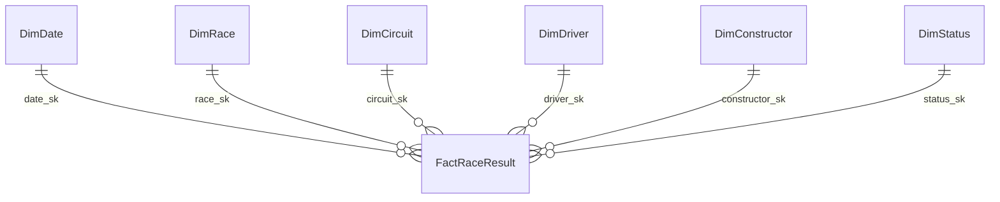

# Kế hoạch Cá nhân Phase 3: Semantic Model & Tích hợp Master PBIX

**Thành viên:** Trực  
**Vai trò:** Semantic Model Architect, Centralized DAX Specialist & Master PBIX Integrator  
**Điểm tải công việc:** **25 điểm**  
**Thời hạn hoàn thành:** Theo lộ trình giai đoạn Phase 3; nghiệm thu trước ngày bảo vệ seminar  
**Phối hợp với:** Dũng (nhận kết nối SQL Server DW), Phúc (đồng bộ layout, tiếp nhận kịch bản QA), Dung & Lộc (phê duyệt DAX và tích hợp visuals Trang 2, 3)  
**Trạng thái:** **[ ] ĐANG THỰC HIỆN**

---

> [!WARNING]
> ### 2 Nguyên tắc Vàng Kỹ thuật Bắt buộc (Trực Giám sát & Quản trị Tập trung)
> 1. **Độc quyền Quản trị Mô hình Dữ liệu (Semantic Model):** Trực là người duy nhất sở hữu và điều chỉnh quan hệ bảng (relationships 1-N), phân cấp (hierarchies), kiểu dữ liệu và thuộc tính cột. Các thành viên khác chỉ thao tác kéo thả trên Report Canvas để tránh xung đột khi tích hợp.
> 2. **Quản trị Tập trung Thư viện Measure DAX:** Toàn bộ công thức đo lường bắt buộc phải nằm trong bảng ảo `_Measures`. Tiếp nhận, phê duyệt và cập nhật mọi measure mới phát sinh từ Dung và Lộc để đảm bảo không bị trùng lặp hay phân mảnh logic.

---

## 1. Mục tiêu & Trách nhiệm của Trực trong Phase 3

Là kiến trúc sư Semantic Model và người tích hợp chính của báo cáo Power BI, Trực chịu trách nhiệm tuyệt đối về sự toàn vẹn của mô hình dữ liệu, thư viện DAX và file đóng gói bàn giao cuối cùng:
1. **Thiết lập & Quản trị Semantic Model Chuẩn duy nhất:** Kết nối Power BI Desktop vào SQL Server schema `dw`, xây dựng mô hình Star Schema thuần túy gồm 1 Fact (`FactRaceResult`) và 6 Dimensions (`DimDate`, `DimRace`, `DimCircuit`, `DimDriver`, `DimConstructor`, `DimStatus`).
2. **Quy chuẩn Relationships & Hierarchies:** Thiết lập 6 quan hệ 1-N một chiều (Single cross-filter direction), đảm bảo tính duy nhất của khóa chiều, tạo 6 phân cấp (Hierarchies) chuẩn hóa và cấu hình Sort By Column cho các trường thời gian.
3. **Quản trị Tập trung Thư viện DAX Measures:** Xây dựng bảng ảo `_Measures` chứa toàn bộ các chỉ số tính toán cốt lõi. Kiểm soát quy trình yêu cầu/phê duyệt measure mới từ Dung và Lộc để ngăn chặn phân mảnh logic.
4. **Khởi tạo & Phân phối File Master Template:** Tạo khung báo cáo chuẩn (3 trang trắng, kích thước 16:9, bảng màu và theme nhất quán) và phân phối bản sao cho các thành viên làm việc độc lập.
5. **Chủ trì Tích hợp Visuals & Đóng gói Bàn giao (`F1_Analytics_Final.pbix`):** Sao chép trực quan từ các file nhánh của Phúc, Dung, Lộc vào file Master; cấu hình Sync Slicers, Visual Interactions, Bookmarks và tối ưu dung lượng file.

---

## 2. Phân rã Công việc & Điểm số (25 Điểm)

| STT | Nhiệm vụ chi tiết | Điểm | Hạn chót | Tiêu chí nghiệm thu (Definition of Done) |
|:---:|---|:---:|:---:|---|
| **1** | **Kết nối SQL Server DW & Xây dựng Star Schema**<br/>Kết nối Power BI tới database `F1_BI` (schema `dw`); nạp 1 Fact và 6 Dimension; cấu hình 6 quan hệ 1-to-Many single direction; ẩn các khóa ngoại `*_sk` trên Fact để người dùng không kéo thả nhầm. | **5** | Bước 1 | - 100% quan hệ là 1-N (Single).<br/>- Không có quan hệ N-N hoặc vòng lọc.<br/>- Bảng Fact liên kết hợp lệ với toàn bộ 6 chiều, không phát sinh dòng blank ảo do orphan key. |
| **2** | **Cấu hình 6 Hierarchies, Sort By Column & Data Categories**<br/>Tạo 6 Hierarchies: `DimRace`, `DimDate`, `DimCircuit`, `DimDriver`, `DimConstructor`, `DimStatus`. Cấu hình `month_name` Sort By `month_number`; gán Data Category cho `country`, `latitude`, `longitude`, `wiki_url`. | **5** | Bước 2 | - Khi drill-down trên visual, các cấp phân cấp hiển thị mượt mà.<br/>- Tên tháng hiển thị đúng thứ tự từ Jan đến Dec (không theo bảng chữ cái).<br/>- Các cột địa lý nhận diện đúng icon trái đất. |
| **3** | **Xây dựng Thư viện DAX Measures Tập trung trong Bảng `_Measures`**<br/>Tạo bảng riêng `_Measures`; viết đầy đủ hơn 15 measures chuẩn: `Total Entries`, `Total Points`, `Wins`, `Podiums`, `Classified Entries`, `Non Classified Rate`, `Mean Classified Finish`, `Avg Places Gained`, `Points Prior Round`, `Points Delta vs Prior Round`... | **6** | Bước 2 | - Bảng `_Measures` nằm ở đầu danh sách trường.<br/>- 100% measures trả về kết quả chính xác, có hàm `DIVIDE` chống lỗi chia cho 0.<br/>- Định dạng chuỗi (Format string: `#,,0`, `0.0%`, `$#,##0`) chuẩn xác. |
| **4** | **Tạo Master Template PBIX & Thiết lập Quy trình Phân nhánh**<br/>Thiết kế layout khung 3 trang trắng: Page 1 (Overview), Page 2 (Performance & Shift), Page 3 (Circuits & Outcomes); thiết lập Canvas 16:9, bảng màu thống nhất (F1 Red/Dark Slate); lưu và gửi file mẫu cho nhóm. | **4** | Bước 3 | - Bàn giao file `F1_Analytics_Master_Template_v1.0.pbix` cho Phúc, Dung, Lộc.<br/>- Thống nhất quy tắc cấm sửa model và quy trình gửi phiếu yêu cầu measure mới. |
| **5** | **Tích hợp Visuals từ 3 Trang & Hoàn thiện File Cuối**<br/>Tiếp nhận 3 file nhánh từ Phúc, Dung, Lộc; copy visuals vào Master PBIX; cấu hình Sync Slicers (mùa giải), Edit Interactions, Tooltips; phối hợp với Phúc chạy đối soát QA và xuất bản file `F1_Analytics_Final.pbix`. | **5** | Bước 5–7 | - Tích hợp thành công visuals của cả 3 trang vào 1 file duy nhất.<br/>- Không có visual nào báo lỗi `Can't display visual`.<br/>- File lưu tại thư mục `powerbi/F1_Analytics_Final.pbix` sẵn sàng nộp bài. |
| **TỔNG** | **Điểm tải công việc Phase 3 của Trực** | **25** | | **Đạt 100% tiêu chí nghiệm thu kiến trúc và tích hợp** |

---

## 3. Chi tiết Kỹ thuật: Cấu hình Model, Hierarchies & Thư viện DAX

### 3.1. Đặc tả Quan hệ Star Schema (Semantic Model Relationships)



- **Quy tắc cấu hình:**
  - `DimDate[date_sk]` $(1) \longrightarrow (*) $ `FactRaceResult[date_sk]` (Single, Active)
  - `DimRace[race_sk]` $(1) \longrightarrow (*) $ `FactRaceResult[race_sk]` (Single, Active)
  - `DimCircuit[circuit_sk]` $(1) \longrightarrow (*) $ `FactRaceResult[circuit_sk]` (Single, Active)
  - `DimDriver[driver_sk]` $(1) \longrightarrow (*) $ `FactRaceResult[driver_sk]` (Single, Active)
  - `DimConstructor[constructor_sk]` $(1) \longrightarrow (*) $ `FactRaceResult[constructor_sk]` (Single, Active)
  - `DimStatus[status_sk]` $(1) \longrightarrow (*) $ `FactRaceResult[status_sk]` (Single, Active)
- **Ẩn trường (Hide in Report View):** Ẩn toàn bộ 6 cột `*_sk` trên bảng Fact; người dùng chỉ sử dụng các trường thuộc tính từ bảng Dimension để cắt lát.

### 3.2. Cấu hình 6 Hierarchies & Cột Sắp xếp (Sort By Column)

1. **`DimRace Hierarchy`:**
   - Cấp 1: `season_year` (Năm mùa giải)
   - Cấp 2: `round_number` (Chặng thứ mấy trong mùa)
   - Cấp 3: `race_name` (Tên chặng Grand Prix)
2. **`DimDate Hierarchy`:**
   - Cấp 1: `year_number` $\rightarrow$ Cấp 2: `quarter_label` $\rightarrow$ Cấp 3: `month_name` $\rightarrow$ Cấp 4: `full_date`
   - *Cấu hình Sort By bắt buộc:* Chọn cột `month_name` $\rightarrow$ Sort By Column: `month_number`; Chọn cột `quarter_label` $\rightarrow$ Sort By Column: `quarter_number`.
3. **`DimCircuit Hierarchy`:**
   - Cấp 1: `country` (Quốc gia) $\rightarrow$ Cấp 2: `circuit_name` (Tên đường đua)
4. **`DimDriver Hierarchy`:**
   - Cấp 1: `driver_nationality` (Quốc tịch) $\rightarrow$ Cấp 2: `full_name` (Họ tên đầy đủ)
5. **`DimConstructor Hierarchy`:**
   - Cấp 1: `constructor_nationality` (Quốc tịch đội) $\rightarrow$ Cấp 2: `constructor_name` (Tên đội đua)
6. **`DimStatus Hierarchy`:**
   - Cấp 1: `outcome_group` (5 nhóm lớn) $\rightarrow$ Cấp 2: `outcome_category` (9 nhóm chi tiết) $\rightarrow$ Cấp 3: `status_label` (141 nhãn gốc)

---

### 3.3. Thư viện DAX Measures Tập trung (Bảng `_Measures`)

```dax
// ===================================================================
// NHÓM 1: QUY MÔ & TỔNG ĐIỂM (Cơ bản)
// ===================================================================

Total Entries = 
COUNTROWS('dw FactRaceResult')

Total Points = 
SUM('dw FactRaceResult'[points])

Points Per Entry = 
DIVIDE([Total Points], [Total Entries], BLANK())

// ===================================================================
// NHÓM 2: THÀNH TÍCH ĐỈNH CAO (Wins & Podiums)
// ===================================================================

Wins = 
CALCULATE(
    COUNTROWS('dw FactRaceResult'),
    'dw FactRaceResult'[position_order] = 1
)

Podiums = 
CALCULATE(
    COUNTROWS('dw FactRaceResult'),
    'dw FactRaceResult'[finish_position] IN {1, 2, 3}
)

Win Rate = 
DIVIDE([Wins], [Total Entries], 0)

Podium Rate = 
DIVIDE([Podiums], [Total Entries], 0)

// ===================================================================
// NHÓM 3: PHÂN LOẠI & ĐỘ TIN CẬY (Classified vs Non-Classified)
// ===================================================================

Classified Entries = 
CALCULATE(
    COUNTROWS('dw FactRaceResult'),
    NOT(ISBLANK('dw FactRaceResult'[finish_position]))
)

Non Classified Entries = 
CALCULATE(
    COUNTROWS('dw FactRaceResult'),
    ISBLANK('dw FactRaceResult'[finish_position])
)

Classified Rate = 
DIVIDE([Classified Entries], [Total Entries], 0)

Non Classified Rate = 
DIVIDE([Non Classified Entries], [Total Entries], 0)

// ===================================================================
// NHÓM 4: PHÂN TÍCH VỊ TRÍ XUẤT PHÁT VS VỀ ĐÍCH (BQ4 Grid Analysis)
// ===================================================================

Eligible Grid Sample Size = 
CALCULATE(
    COUNTROWS('dw FactRaceResult'),
    'dw FactRaceResult'[grid_position] > 0,
    NOT(ISBLANK('dw FactRaceResult'[finish_position]))
)

Mean Classified Finish = 
CALCULATE(
    AVERAGE('dw FactRaceResult'[finish_position]),
    NOT(ISBLANK('dw FactRaceResult'[finish_position]))
)

Avg Places Gained = 
CALCULATE(
    AVERAGE('dw FactRaceResult'[places_gained]),
    'dw FactRaceResult'[grid_position] > 0,
    NOT(ISBLANK('dw FactRaceResult'[finish_position]))
)

// ===================================================================
// NHÓM 5: PHÂN TÍCH BIẾN ĐỘNG & ĐÓNG GÓP (BQ6 Time & Variance Analysis)
// ===================================================================

Points Prior Round = 
VAR CurrentRound = SELECTEDVALUE('dw DimRace'[round_number])
VAR CurrentSeason = SELECTEDVALUE('dw DimRace'[season_year])
RETURN
IF(
    ISBLANK(CurrentRound) || CurrentRound <= 1,
    BLANK(),
    CALCULATE(
        [Total Points],
        REMOVEFILTERS('dw DimRace'),
        'dw DimRace'[season_year] = CurrentSeason,
        'dw DimRace'[round_number] = CurrentRound - 1
    )
)

Points Delta vs Prior Round = 
VAR Prior = [Points Prior Round]
RETURN
IF(ISBLANK(Prior), BLANK(), [Total Points] - Prior)

Constructor Points Contribution Pct = 
VAR DriverPoints = [Total Points]
VAR TeamTotalPoints = 
    CALCULATE(
        [Total Points],
        REMOVEFILTERS('dw DimDriver')
    )
RETURN
DIVIDE(DriverPoints, TeamTotalPoints, 0)
```

---

## 4. Các Giao diện Phối hợp & Bàn giao (Interfaces)

- **Giao diện với Dũng:**
  - Nhận thông tin cấu hình cổng mạng và quyền user SQL Server schema `dw` để kết nối Power BI Desktop.
  - Phối hợp xác nhận số dòng trên Fact (27.568) và các Dim trước khi lưu Master Template.
  - Phê duyệt và hỗ trợ Dung các công thức biến động chặng/mùa giải cho Trang 2 (BQ1, BQ2, BQ6).
- **Giao diện với Phúc:**
  - Thống nhất bảng màu (Theme JSON), kích thước trang (16:9 - 1280x720 px), phông chữ (Segoe UI) và cấu trúc Header/Footer.
  - Bàn giao Master Template để Phúc dựng Trang 1 và chuẩn bị tài liệu QA.
  - Nhận biên bản lỗi từ Phúc trong quá trình đối soát để fix DAX hoặc quan hệ.
- **Giao diện với Lộc:**
  - Hướng dẫn Lộc áp dụng đúng bộ lọc visual cho BQ4 (`grid_position > 0` và `finish_position IS NOT NULL`) và BQ5 (phân rã 5 nhóm `OutcomeGroup`).
  - Phê duyệt các measure tỷ lệ sự cố cơ khí nếu Lộc đề xuất bổ sung.

---

## 5. Tiêu chí Hoàn thành & Kế hoạch Tự Kiểm thử (Definition of Done)

- [ ] File `F1_Analytics_Master_Template_v1.0.pbix` kết nối trực tiếp schema `dw` thành công, lưu tại [powerbi/](file:///c:/Users/truct/source/miniprojectBI/powerbi/).
- [ ] 100% quan hệ là 1-Nhiều, lọc một chiều từ Dimension vào Fact, không có lỗi ambiguously defined path.
- [ ] 6 Hierarchies được tạo đầy đủ; cột `month_name` được sắp xếp theo `month_number`.
- [ ] Bảng `_Measures` chứa đủ 15+ measures, không có measure nào phát sinh lỗi cú pháp.
- [ ] Bản tích hợp `F1_Analytics_Final.pbix` chứa đầy đủ 3 trang trực quan hóa của Phúc, Dung, Lộc; không có lỗi `Can't display visual` khi tương tác bộ lọc.
- [ ] Ký xác nhận biên bản nghiệm thu kỹ thuật Phase 3 cùng Phúc.

