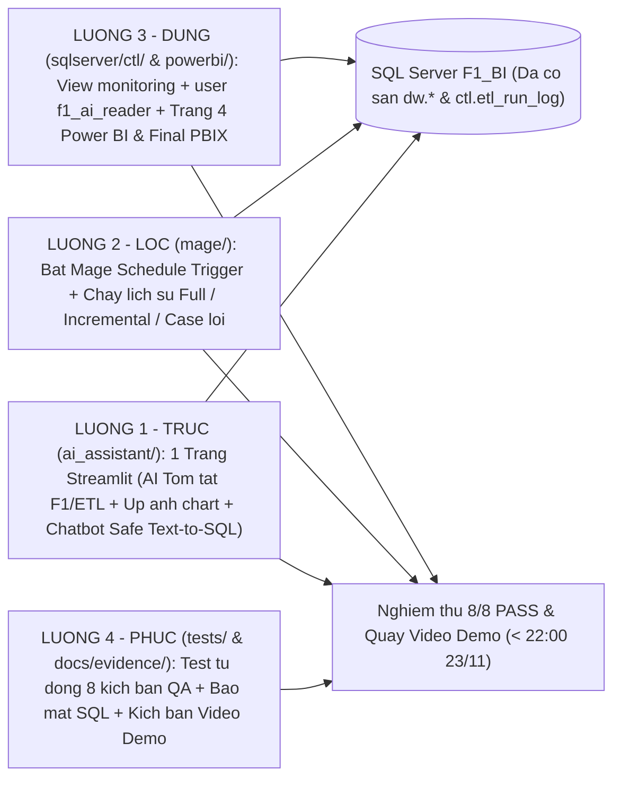

# Kế hoạch Tổng quát MiniProject BI - Phase 4 (Tinh gọn & Độc lập): Generative AI, Lập lịch ETL, Giám sát ETL & QA

**Học phần:** Data Warehouse & Business Intelligence  
**Đồ án:** Formula 1 Analytics (1950–2026)  
**Nhóm sinh viên thực hiện:** Phúc, Dũng, Lộc, Trực  
**Thời gian thực hiện:** 21/11/2026 – 23/11/2026 (**Hạn nộp Bonus Seminar 3: 23:00 Thứ Hai, 23/11/2026**)  
**Nguyên tắc triển khai:** **Tinh gọn – Không làm trùng – 4 luồng kỹ thuật tách biệt 100%**, mỗi thành viên sở hữu riêng một thư mục và bắt tay làm được **ngay lập tức** trên hạ tầng có sẵn từ Phase 1–3, không ai phải chờ ai.

---

## 1. Phạm vi Kỹ thuật Phase 4 (Đủ 100% Mục 3.5 + 100% Bonus Seminar 3)

| Yêu cầu đề bài & Bonus | Giải pháp tinh gọn (Mỗi thứ làm đúng 1 nơi) | Tái sử dụng từ Phase 1–3 |
|---|---|---|
| **Generative AI & Chatbot Hỏi–Đáp** *(Mục 3.5 + Bonus)* | **1 ứng dụng Streamlit duy nhất (1 trang gọn)** trong `ai_assistant/` dùng **Google Gemini API (Flash Free Tier — 0 VNĐ)**:<br/>• *Phần trên:* Chọn phân tích **F1 (`dw.*`)** hoặc **Kết quả ETL (`ctl.etl_run_log`)** → bấm **Tạo tóm tắt AI** (kèm ô upload ảnh chụp đồ thị Power BI tùy chọn).<br/>• *Phần dưới:* **Chatbot Hỏi–Đáp tiếng Việt (Safe Text-to-SQL)** hỏi được cả F1 & ETL, chặn `DROP/DELETE/UPDATE`, hiển thị câu SQL + bảng số liệu gốc kiểm chứng. | Đọc thẳng `dw.*` (Phase 2) và `ctl.etl_run_log`, `ctl.etl_batch_state` (Phase 1) đã có sẵn trong SQL Server `F1_BI`. |
| **Lập lịch ETL tự động** *(Bonus)* | Bật **Schedule Trigger** định kỳ trên Mage.ai chạy pipeline `f1_source_to_stage` có sẵn + chạy sinh lịch sử Full, Incremental và 1 case lỗi giả lập. *(Không thêm block AI vào Mage, không tạo thêm bảng log mới).* | Pipeline `f1_source_to_stage` và audit log `ctl.etl_run_log` đã chạy ổn định. |
| **Dashboard giám sát ETL** *(Bonus)* | Thêm đúng **1 trang (Trang 4: ETL Monitoring)** vào Power BI đọc từ `ctl.vw_etl_run_monitoring` & `ctl.etl_batch_state` và đóng gói vào `F1_Analytics_Final.pbix`. *(Không vẽ trùng Dashboard ETL trên Streamlit).* | File Master PBIX 3 trang F1 đã có sẵn từ Phase 3. |
| **Kiểm định QA & Kịch bản Demo** | Tự động hóa kiểm thử **8 kịch bản QA cốt lõi** (AI Grounding chống bịa số, bảo mật SQL Injection 2 lớp, đối soát Trang 4 vs `ctl`, kiểm tra Mage Trigger) + soạn **Kịch bản Video Demo 5–7 phút**. | Baseline đối soát Phase 2–3 và khung `pytest` trong `tests/`. |

---

## 2. Kiến trúc 4 Luồng Độc lập (0% Chờ nhau, 0% Xung đột Git)



### Ranh giới Thư mục Độc lập

```text
miniprojectBI/
├── ai_assistant/                                     # [LUỒNG 1 - Trực] Trọn gói AI & 1 trang Streamlit duy nhất
│   ├── ai_core.py                                    # Kết nối DB, lấy KPI thật dw/ctl, gọi Gemini API (Text + Ảnh)
│   ├── text_to_sql.py                                # Schema catalog + chặn SQL ghi/xóa + chạy SELECT + giải thích
│   ├── app.py                                        # 1 trang Streamlit duy nhất (Tóm tắt AI + Chatbot Q&A)
│   └── requirements.txt                              # Thư viện gọn nhẹ chạy 1 lệnh
├── mage/                                             # [LUỒNG 2 - Lộc] Schedule Trigger & chạy lịch sử ETL
├── sqlserver/ctl/                                    # [LUỒNG 3 - Dũng] 1 file SQL: vw_etl_run_monitoring + f1_ai_reader
│   └── 01_etl_monitoring_view_and_reader.sql
├── powerbi/                                          # [LUỒNG 3 - Dũng] Trang 4 ETL Monitoring & đóng gói F1_Analytics_Final.pbix
│   ├── F1_Analytics_Dev_Page4_ETL_Monitoring_Dung.pbix
│   └── F1_Analytics_Final.pbix
├── tests/
│   └── test_phase4_qa.py                             # [LUỒNG 4 - Phúc] Kiểm thử tự động 8 kịch bản QA & bảo mật SQL
└── docs/
    ├── 04_operations_and_guides/phase4_demo_script.md # [LUỒNG 4 - Phúc] Kịch bản Video Demo 5–7 phút
    └── evidence/phuc_phase4_qa_validation.md         # [LUỒNG 4 - Phúc] Biên bản nghiệm thu QA Phase 4
```

---

## 3. Phân công 4 Thành viên (25 điểm / người — Bắt đầu NGAY TỪ PHÚT 0)

| Thành viên | Luồng độc lập | Nhiệm vụ làm NGAY BÂY GIỜ (Không chờ ai) | File kế hoạch chi tiết | Điểm |
|---|---|---|---|:---:|
| **Trực** | **Luồng 1:** Trọn gói Generative AI & Streamlit (`ai_assistant/`) | Tự chủ trọn gói **3 file Python gọn** nối thẳng `dw.*` & `ctl.etl_run_log` đã có sẵn (sau đổi 2 dòng `.env` sang `f1_ai_reader`):<br/>1. `ai_core.py`: lấy số liệu thật F1/ETL + gọi Gemini Flash (Text + ảnh biểu đồ).<br/>2. `text_to_sql.py`: sinh T-SQL `SELECT` an toàn (chặn `DROP/DELETE/UPDATE`) + giải thích.<br/>3. `app.py` + `requirements.txt`: **1 trang Streamlit duy nhất** (Tóm tắt AI F1/ETL ở trên + Chatbot Hỏi–Đáp ở dưới) + cập nhật `.env.example`. | [`01_ke_hoach_truc_ai_assistant_streamlit_text_to_sql.md`](01_ke_hoach_truc_ai_assistant_streamlit_text_to_sql.md) | **25** |
| **Lộc** | **Luồng 2:** Lập lịch ETL Mage.ai (`mage/`) | Đúng sở trường Mage từ Phase 1, làm ngay trên `f1_source_to_stage`:<br/>1. Cấu hình & bật **Schedule Trigger** chạy định kỳ trên Mage.ai.<br/>2. Chạy tạo lịch sử thật trong `ctl.etl_run_log`: Full Load 7 bảng + `dbt build`, Incremental Load (batch mới + rerun) và **1 case giả lập lỗi kiểm định** (rollback sạch, không hỏng `dw`).<br/>3. Lưu bằng chứng Trigger UI + log lịch sử + hướng dẫn bật lịch. | [`02_ke_hoach_loc_mage_etl_scheduler.md`](02_ke_hoach_loc_mage_etl_scheduler.md) | **25** |
| **Dũng** | **Luồng 3:** SQL Monitoring View, User Read-Only & Power BI Trang 4 (`sqlserver/ctl/` & `powerbi/`) | Làm ngay trên `ctl.etl_run_log` & `ctl.etl_batch_state` đã có sẵn:<br/>1. Viết **1 file SQL** tạo view `ctl.vw_etl_run_monitoring` + user chỉ đọc `f1_ai_reader`.<br/>2. Dựng **Trang 4 Power BI (ETL Monitoring)** và tích hợp luôn vào `powerbi/F1_Analytics_Final.pbix` (thêm nút chuyển trang Trang 1 <-> Trang 4).<br/>3. Đối soát 5 KPI Cards Trang 4 khớp `ctl.etl_run_log`. | [`03_ke_hoach_dung_sql_monitoring_powerbi_page4.md`](03_ke_hoach_dung_sql_monitoring_powerbi_page4.md) | **25** |
| **Phúc** | **Luồng 4:** Lead QA (AI Grounding, Bảo mật SQL, ETL) & Kịch bản Video Demo (`tests/` & `docs/evidence/`) | Làm ngay không phải chờ code xong:<br/>1. Viết bộ test tự động `tests/test_phase4_qa.py` (10+ mẫu tấn công SQL/Prompt Injection, test quyền `f1_ai_reader`, Ground Truth SQL cho F1 & ETL).<br/>2. Soạn **Kịch bản Video Demo End-to-End (5–7 phút)** phân vai thao tác cụ thể.<br/>3. Chạy trọn **8 kịch bản QA cốt lõi**, xuất biên bản nghiệm thu `phuc_phase4_qa_validation.md` & điều phối quay Demo. | [`04_ke_hoach_phuc_qa_security_demo.md`](04_ke_hoach_phuc_qa_security_demo.md) | **25** |

> **Tại sao 4 người KHÔNG bị lệ thuộc nhau?**
> - **Trực** nối thẳng vào `dw.*` và `ctl.etl_run_log` **đã có sẵn** bằng `.env` hiện tại — xong `f1_ai_reader` của Dũng chỉ sửa đúng 2 dòng `.env`, không sửa dòng code nào.
> - **Lộc** làm hoàn toàn trên `mage/` (không đụng AI, không đụng Power BI).
> - **Dũng** dựng Trang 4 từ `ctl.etl_run_log` đã có sẵn log Phase 1–2 và ghép luôn vào `F1_Analytics_Final.pbix` (lát Lộc chạy thêm lịch chỉ bấm **Refresh**).
> - **Phúc** viết ngay `tests/test_phase4_qa.py` (test bảo mật + Ground Truth SQL) và Kịch bản Video Demo từ chiều 21/11.

---

## 4. Lộ trình 2 Ngày Gọn nhẹ (21/11 – 23/11/2026)

| Khung giờ | 4 Luồng chạy song song độc lập | Mốc đồng bộ (Sync Point) |
|---|---|---|
| **Chiều & Tối T7 (21/11, 17:00 – 23:00)** | - **Trực:** Viết xong `ai_core.py` + `text_to_sql.py` (chạy thử Tóm tắt AI & câu hỏi mẫu trên `dw`/`ctl`).<br/>- **Lộc:** Bật Mage Schedule Trigger + xác nhận tự chạy định kỳ.<br/>- **Dũng:** Chạy xong 1 file SQL (`vw_etl_run_monitoring` + `f1_ai_reader`) + bắt đầu dựng Trang 4 Power BI.<br/>- **Phúc:** Viết xong khung `tests/test_phase4_qa.py` (10+ test Injection + Ground Truth SQL) + khung Kịch bản Demo 5–7 phút. | **Sync 1 (23:00 T7):** Dũng gửi user `f1_ai_reader` cho Trực điền `.env`; chốt không có vướng môi trường. |
| **Sáng & Chiều CN (22/11, 09:00 – 18:00)** | - **Trực:** Hoàn thiện 1 trang Streamlit `app.py` + `requirements.txt` + `.env.example` (test đủ Tóm tắt F1/ETL, up ảnh chart, Chatbot Q&A).<br/>- **Lộc:** Chạy đủ 3 kịch bản lịch sử (Full + Incremental + 1 case giả lập lỗi) và lưu bằng chứng Trigger + log.<br/>- **Dũng:** Hoàn tất Trang 4 Power BI, bấm Refresh đón log mới của Lộc và đóng gói `powerbi/F1_Analytics_Final.pbix` 4 trang.<br/>- **Phúc:** Chạy vòng 1 test bảo mật & đối soát số liệu, hoàn thiện Kịch bản Video Demo. | **Sync 2 (18:00 CN):** Freeze code 3 luồng kỹ thuật (`ai_assistant/`, `mage/`, `F1_Analytics_Final.pbix`). |
| **Tối CN & Sáng T2 (22/11 19:00 – 23/11 12:00)** | - **Phúc (chủ trì) + Cả nhóm:** Thực thi trọn **8 kịch bản QA cốt lõi**, sửa sạch mọi bug phát sinh, chốt biên bản `phuc_phase4_qa_validation.md`. | **Sync 3 (12:00 T2):** **8/8 QA PASS** — sẵn sàng quay Demo. |
| **Chiều & Tối T2 (23/11, 13:00 – 22:00)** | - **Cả nhóm:** Quay **Video Demo End-to-End (5–7 phút)** theo kịch bản của Phúc, kiểm tra không lộ `.env` / API key và hoàn tất nộp bài trước **22:00** (trước hạn 23:00 ít nhất 1 giờ). | **HOÀN TẤT NỘP BÀI (< 22:00 T2 23/11).** |

---

## 5. Tiêu chí Nghiệm thu Phase 4 (8/8 PASS)

- [ ] **1. Lập lịch ETL:** Mage.ai Schedule Trigger đang `ACTIVE`, có lịch sử chạy tự động gồm Full Load, Incremental Load và 1 case lỗi ghi nhận trong `ctl.etl_run_log`.
- [ ] **2. Dashboard Giám sát ETL:** Trang 4 trong `F1_Analytics_Final.pbix` hiển thị đúng 5 KPI Cards, xu hướng chạy và `error_message` khớp 100% `ctl.etl_run_log`.
- [ ] **3. AI Tóm tắt F1:** Trang Streamlit sinh bản tóm tắt F1 đúng số liệu thật từ `dw.*` (không bịa số, giữ đúng quy tắc BQ4/BQ5/BQ6 & caveat thang điểm); hỗ trợ đính kèm ảnh chụp đồ thị Power BI đối chiếu.
- [ ] **4. AI Giải thích kết quả ETL:** Trang Streamlit đọc `ctl.etl_run_log` giải thích chính xác kết quả các lần chạy gần nhất và chỉ đúng bảng bị lỗi/reject kèm gợi ý xử lý.
- [ ] **5. Chatbot Hỏi–Đáp (F1 & ETL):** Hỏi tiếng Việt tự nhiên cho cả F1 và ETL, sinh T-SQL `SELECT`, hiển thị câu SQL + bảng kết quả gốc để kiểm chứng.
- [ ] **6. Bảo mật Text-to-SQL (2 lớp):** Chặn 100% lệnh phá hoại (`DROP`, `DELETE`, `UPDATE`, đa câu lệnh `;`) ở cả validator Python lẫn user chỉ đọc `f1_ai_reader`.
- [ ] **7. An toàn bí mật:** Không commit `.env` hay `GEMINI_API_KEY` thật lên Git.
- [ ] **8. Quay xong Video Demo & Nghiệm thu:** Video Demo 5–7 phút rõ nét đi trọn luồng hệ thống + biên bản QA 8/8 PASS.
